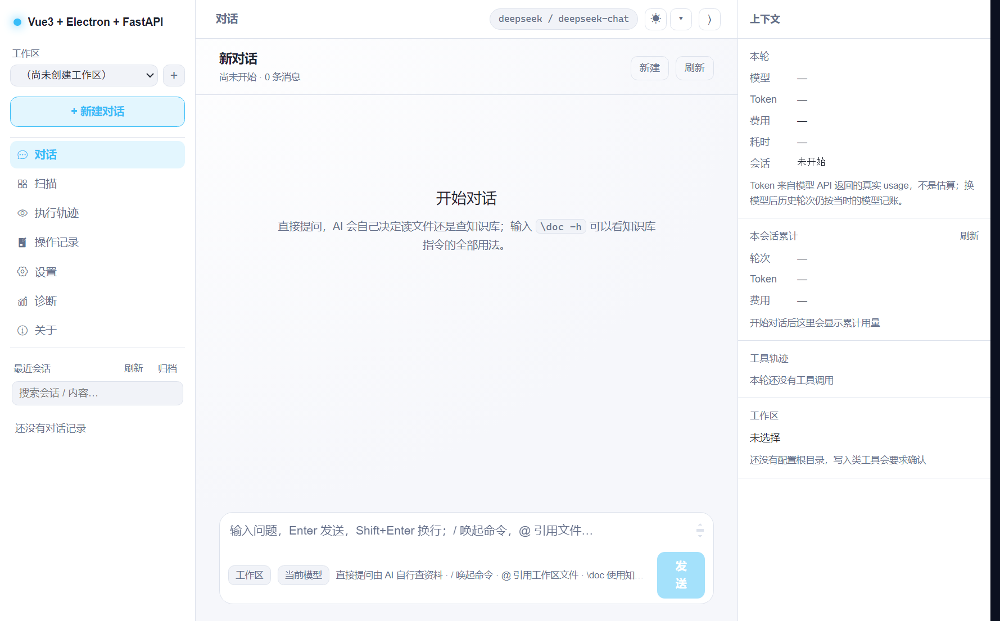
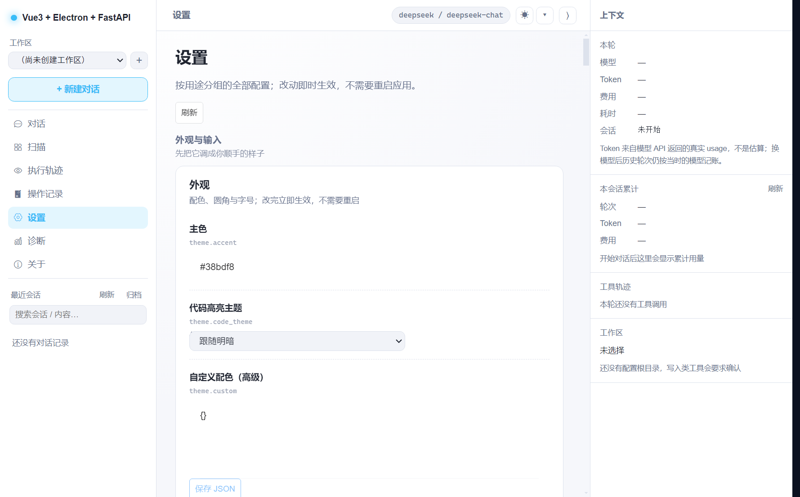
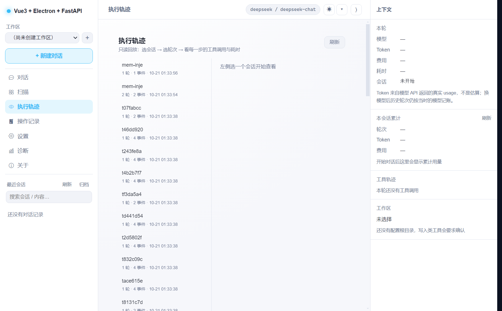
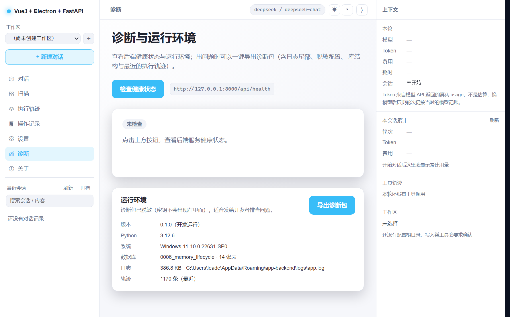

# vue3-electron-fastapi

**本机优先的桌面 AI 客户端** —— 一份代码多端运行：Electron 桌面壳 + Vue3/TypeScript 前端 + Python/FastAPI 后端。

对标 Claude Code / Cursor 的形态，但坚持「**本机文件 + 知识库**」定位：不依赖云端账号，工作区就是你的本地目录，知识库就是你的本地文档。

[](https://www.electronjs.org/)
[](https://vuejs.org/)
[](https://www.typescriptlang.org/)
[](https://fastapi.tiangolo.com/)
[](https://www.python.org/)
[](https://pnpm.io/)
[](https://docs.astral.sh/uv/)

---

## 这是什么

一个从「学习外壳」一路长成的**真正可用的桌面 AI 客户端**。最初它只是一个健康检查的最小闭环
（前端按钮 → `GET /api/health` → 后端返回运行时信息），经过 M0~M6 六个里程碑的改造，现在具备：

- **多 AI 供应商**：DeepSeek / OpenAI / Anthropic / Gemini / Ollama（本地），可配置、可运行时切换；
- **可视化设置**：模型、密钥、工作区、主题、工具开关全在设置页里改，不再手改 `.env`；
- **多工作区**：可定义多个工作区（profile），随时切换当前生效的那一个；
- **可扩展**：支持安装 **Skill** 与 **MCP 服务**，工具能力可插拔；
- **现代体验**：CC 式三栏页面、主题定制、Markdown 与代码高亮、文件引用跳转；
- **工程可靠**：数据库可迁移、密钥不入库、日志可诊断、可自动更新。

> 这是一份**新手学习项目**，代码注释标准比商业项目更严：每个字段、每个方法、每条 import 都要
> 说明用途（详见 [`AGENTS.md`](./AGENTS.md)）。想读懂「运行时到底怎么跑的」，从
> [`doc/链路/`](./doc/链路/README.md) 入手。

---

## 界面预览

**对话主界面**（三栏布局：左栏导航 / 中栏对话 / 右栏上下文）



**设置页**（后端「声明式注册表」驱动，按分类自动渲染）



**执行轨迹回放**（会话 → 轮次 → 事件三级钻取）



**诊断与运行环境**（健康检查 + 一键导出脱敏诊断包）



---

## 技术栈

| 层 | 技术 | 说明 |
| --- | --- | --- |
| 桌面壳 | Electron + electron-vite + electron-builder | 启动/关闭本地 Python 后端，打包成 Windows / macOS / Linux 安装包 |
| 页面 | Vue3 + TypeScript + Vue Router + Pinia + Vite | 既是浏览器单页调试，也是 Electron 的渲染进程 |
| 后端 | Python + FastAPI + uvicorn（uv 管理依赖） | 分层：api → controllers → services → schemas |
| 智能体 | LangGraph | 流式 SSE 对话、工具调用、人工确认（HITL）、子 agent 派发 |
| 依赖管理 | uv（Python）+ pnpm workspace（JS/TS） | 根目录一条命令装齐 |

---

## 快速开始

前置要求：`uv`、**pnpm**（`npm i -g pnpm` 或 `corepack enable pnpm`）、Node.js ≥ 18、Python ≥ 3.10
（uv 会自动下载/使用合适的解释器）。JS/TS 侧只用 pnpm。

```bash
# 0) 克隆后进入项目根目录
cd project

# 1) 一键初始化：装 Python 依赖 + 装 JS/TS 依赖（pnpm 工作区会同时装 frontend 与 electron）
pnpm run setup

# 2)（可选）生成本地配置文件
cp .env.example .env                 # Windows: copy .env.example .env
cp frontend/.env.example frontend/.env

# 3) 一键启动三件套：FastAPI(8000) + Vite(5173) + Electron 窗口
pnpm run dev
```

启动后：Electron 会自动拉起/复用 `127.0.0.1:8000` 的后端，接口文档在 <http://127.0.0.1:8000/docs>。

### 日常开发

```bash
pnpm run dev              # 一键启动三件套
pnpm run dev:backend      # 只跑后端   → http://127.0.0.1:8000
pnpm run dev:web          # 只跑浏览器页面 → http://127.0.0.1:5173
pnpm run dev:desktop      # 只跑 Electron（渲染层复用 frontend/）

pnpm run test             # 前后端全部测试（= test:backend && test:frontend）
pnpm run test:backend     # 后端 pytest（385 条用例）
pnpm run test:frontend    # 前端 vitest（124 条用例）
pnpm run typecheck        # 前端 vue-tsc + electron tsc 类型检查
pnpm run check:migrations # 迁移漂移校验（临时库跑 alembic check）
```

> **关于包管理器**：本仓库只用 **pnpm** 管理 JS/TS 依赖（Python 侧始终是 `uv`），请不要用
> `npm install` / `yarn`，那会生成第二套锁文件与 `node_modules` 布局。工作区由根目录
> `pnpm-workspace.yaml` 定义（`frontend` + `electron` 两个成员）。国内网络首次安装 Electron
> 运行时建议设镜像：`$env:ELECTRON_MIRROR='https://npmmirror.com/mirrors/electron/'`。

---

## 项目结构

```
project/
├─ package.json               # 根：pnpm 工作区脚本（dev / build / dist / test）
├─ pnpm-workspace.yaml        # JS/TS 侧工作区定义（frontend + electron）
├─ .env.example               # 全项目配置示例
├─ AGENTS.md                  # 编码硬性要求（字段/方法/import 都要注释）
├─ scripts/                   # 开发启动器、构建同步、迁移校验等脚本
├─ doc/                       # 改造方案总纲 + 各层分册 + 链路说明
│
├─ backend/                   # Python 后端（uv 工程）
│  ├─ pyproject.toml          # uv 依赖与入口定义
│  ├─ run.py                  # 启动入口：uv run python run.py [--port 8000] [--reload]
│  ├─ alembic.ini + migrations/  # 数据库迁移（Alembic）
│  ├─ app-backend.spec        # PyInstaller 打包配置（生成独立可执行后端）
│  └─ app/
│     ├─ main.py              # 应用工厂 create_app()
│     ├─ api/                 # 路由聚合
│     ├─ controllers/         # HTTP 层：chat / setting / memory / mcp / skill / trace / diagnostic…
│     ├─ services/            # 业务逻辑：settings_registry / secrets / task_planner / memory_service…
│     ├─ schemas/             # Pydantic 模型（统一响应外壳）
│     ├─ entity/              # ORM 实体（会话 / 工作区 / 授权 / 记忆 / 轨迹…）
│     ├─ agents/              # LangGraph Agent（rag_agent）
│     ├─ llm/                 # 模型 Provider 抽象（registry / factory / state）
│     ├─ tools/               # 内置工具 + policy 安全裁决 + 输出治理
│     ├─ skills/  mcp/        # Skill 发现注册 / MCP 客户端
│     ├─ core/  db/  dto/     # 日志路径 / 数据库 / 传输对象
│     └─ tests/               # 385 条 pytest 用例
│
├─ frontend/                  # Vue3 前端（同时是 Electron 渲染进程）
│  ├─ vite.config.ts          # 端口 5173、/api 代理、base './'
│  └─ src/
│     ├─ router/index.ts      # Vue Router（hash 模式，适配 file://）
│     ├─ views/               # 对话（chat/）、设置、执行轨迹、诊断、扫描、关于…
│     ├─ components/          # layout（三栏骨架）、settings、MarkdownView…
│     ├─ stores/  services/   # Pinia 状态 / 请求封装
│     ├─ themes/  composables/  # 主题 token 与预设 / useTheme
│     └─ tests/               # 124 条 vitest 用例
│
└─ electron/                  # Electron 外壳
   ├─ electron.vite.config.ts # main / preload 打包，renderer 复用 ../frontend
   ├─ electron-builder.yml    # 多端安装包配置
   └─ src/
      ├─ main/                # 主进程：建窗口、起后端、退出收后端、自动更新
      ├─ preload/             # contextBridge 暴露 window.desktop
      └─ shared/              # 端口、健康检查路径等共享常量
```

---

## 核心能力

### 模型与设置

- **多 Provider 抽象**：`llm/registry.py` 内置 DeepSeek / OpenAI / Anthropic / Gemini / Ollama 五个
  Provider，自定义模型可覆盖、自定义 OpenAI 兼容端点可并存；`llm/factory.py` 三级 key 解析
  （显式参数 → keyring → `.env`）。
- **声明式设置体系**：所有配置统一走 `PUT /api/settings/*`，一个 `SettingDef` 声明即自动出现在
  设置页（meta 驱动、前端零硬编码），目前已有 **118+ 个设置键**。
- **密钥安全**：密钥走系统钥匙串（keyring）优先、Fernet 降级，接口只返回脱敏值（前 3 + `****` + 后 4）。

### 对话体验

- **CC 式三栏布局**：左栏（工作区/会话导航）、中栏（对话）、右栏（本轮用量/工具轨迹/文件预览）均可折叠。
- **流式对话**：SSE 事件流 + LangGraph Agent；Markdown 渲染（markdown-it + highlight.js + DOMPurify 净化）、
  代码块复制、文件引用胶囊点击预览。
- **会话管理**：重命名、搜索（防抖 + 下推 SQL）、置顶 / 归档 / 单会话导出。
- **Token / 成本面板**：本轮与整会话累计的真实 usage；超预算可熔断（token / 费用 / 时长三维度）。
- **权限三档**：`ask`（逐次确认）/ `workspace`（工作区免问）/ `allow`，确认弹窗可「记住本工作区授权」。
- **快捷指令**：`@` 引用工作区文件、`/` 唤起命令、模型胶囊切换。
- **执行中插话与打断**：`POST /chat/{id}/steer` 把用户原话注入工具结果、取消未开始的工具。
- **主题定制**：4 套预设（slate / midnight / paper / nord）× 明暗，主色 / 圆角 / 字号 / 代码主题可调。

### 扩展能力

- **Skill 系统**：`root/*/SKILL.md` 目录发现 + `/技能名 参数` 调用 + 设置页启停管理，提示词只注入
  名字与描述、正文按需读，技能再多也不撑爆系统提示词。
- **MCP 客户端**：stdio / sse / streamable_http 四种传输，工具统一过 `policy` 裁决（默认 DENY，
  逐个登记策略），单 server 失败隔离。
- **内置工具生态**：文件读写、grep、目录遍历、`http_request`、`sql_query`（只读白名单）、
  RAG 检索等，全部走统一出口（裁决 → 预算 → 确认 → 执行 → 截断 → 审计）。
- **文档解析**：pdf / docx / txt / **xlsx** 注册表一处注册全局生效；Office 家族（含旧版 doc/xls/ppt）
  改走本地 Office CLI，引擎未启动时自动降级读取并拒绝乱码入库。
- **RAG 知识库**：FAISS 索引 + 文档入库/检索，`\doc` 指令直接检索。
- **复杂任务拆分**：强度判定 → 子任务拆分 → 执行 → 验证闭环 → 汇总；支持分道并行、文件锁、
  快照回滚、动态重规划。
- **子 agent 派发**：`dispatch_subagent` 工具，子 agent 只读工具集 + 强制 ASK 红线 + 独立 thread 隔离。

### 工程可靠

- **数据库迁移**：Alembic 基线（手写、禁 autogenerate），启动期幂等执行，提交前 `alembic check` 零漂移校验。
- **会话持久化**：`SqliteSaver` 落库，重启不丢对话、不丢现场。
- **工作空间记忆**：每轮结束自动抽取、本地检索注入新对话首条消息；真 embedding 双后端（本地/远端）、
  近似重复合并、过期淘汰、向量一键重建。
- **上下文管理**：token 估算 + 超阈值摘要压缩（摘要失败走机械兜底），长对话不爆上下文。
- **日志与诊断**：滚动文件日志（5MB × 5 份）+ 一键导出脱敏诊断包（不含任何密钥）。
- **执行轨迹**：`trace_events` 表结构化留存，`/trace` 页三级钻取回放。
- **自动更新**：electron-updater + 「关于」页检查更新；**配置导入导出**：脱敏 JSON + 逐键取舍。

---

## 打包发布

打包分两步：**先打前端 + 后端，再打 Electron 安装包**。

```bash
# ① 前端静态资源 → frontend/dist
pnpm run build:web

# ② 后端独立可执行文件 → backend/dist/app-backend/，并自动同步到 electron/resources/backend/
pnpm run build:backend

# ③ 打当前平台安装包（内部会先执行 electron-vite build）
pnpm run dist            # 当前平台
pnpm run dist:win        # Windows → NSIS 安装程序
pnpm run dist:mac        # macOS   → dmg（需在 macOS 上执行）
pnpm run dist:linux      # Linux   → AppImage + deb
```

产物位置：

- Electron 编译产物：`electron/out/`（main / preload）
- 前端页面产物：`frontend/dist/`
- 安装包：`electron/dist/`（如 `Vue3ElectronFastAPI-0.1.0-win-x64.exe`）
- 免安装目录版：`electron/dist/win-unpacked/`，其中 `resources/backend/`、`resources/renderer/`
  就是后端 exe 与前端页面

> 国内网络首次打包需设镜像（Electron 二进制与打包工具链都靠联网下载）：
> `$env:ELECTRON_MIRROR='https://npmmirror.com/mirrors/electron/'`、
> `$env:ELECTRON_BUILDER_BINARIES_MIRROR='https://npmmirror.com/mirrors/electron-builder-binaries/'`。

---

## 配置说明

| 配置 | 说明 |
| --- | --- |
| 后端 `APP_*` | `backend/app/config.py` 前缀 `APP_`：`APP_PORT`（默认 8000，须与 Electron 一致）、`APP_API_PREFIX`、`APP_CORS_ORIGINS`… |
| 前端 `VITE_*` | `frontend/.env` 前缀 `VITE_`：`VITE_API_BASE_URL`、`VITE_BACKEND_PROXY`；`file://` 下自动用 `http://127.0.0.1:<API_PORT>` |
| Electron | `APP_PORT`、`PYTHON_BACKEND_EXE`（指定后端 exe）、`PYTHON_BACKEND_CMD`（自定义启动命令）、`ELECTRON_DEBUG_PORT`（远程调试）… |

**运行期「谁来启动后端」**：主进程先探测 `127.0.0.1:<port>/api/health`，已有后端就复用；否则依次找
打包好的 exe（`PYTHON_BACKEND_EXE` → `resources/backend/app-backend.exe`），都没有就用
`uv run python run.py` 在 `backend/` 拉起。只有「自己拉起的」进程才会在退出时被关闭；强杀场景靠
`APP_PARENT_GUARD` + stdin 心跳兜底，不留孤儿进程。

---

## 文档导航

改造工作的总纲与各层实施方案都在 `doc/` 下：

| 文档 | 内容 |
| --- | --- |
| [`20-改造总计划.md`](./doc/20-改造总计划.md) | 总纲：目标、分层、里程碑、依赖顺序 |
| [`21-架构层改造方案.md`](./doc/21-架构层改造方案.md) | Provider 抽象、设置、工作区、会话、上下文、插话、子 agent |
| [`22-扩展性层改造方案.md`](./doc/22-扩展性层改造方案.md) | Skill、MCP、工具生态、文档解析 |
| [`23-体验层改造方案.md`](./doc/23-体验层改造方案.md) | 三栏重构、主题、Markdown、会话、统计 |
| [`24-工程化与运维改造方案.md`](./doc/24-工程化与运维改造方案.md) | 迁移、密钥、日志、自动更新、导入导出、trace |
| [`25-工作空间记忆方案.md`](./doc/25-工作空间记忆方案.md) | 记忆抽取 / 检索 / 增强 |
| [`26-复杂任务拆分方案.md`](./doc/26-复杂任务拆分方案.md) | 任务拆分 / 执行 / 验证 / 重规划 |
| [`27-设置体系规范.md`](./doc/27-设置体系规范.md) | 统一入口、命名空间、声明式注册 |
| [`链路/README.md`](./doc/链路/README.md) | 运行时链路：大模型调用、工具执行、权限判断 |

---

## 常见问题

| 现象 | 处理 |
| --- | --- |
| 页面提示「无法连接后端服务」 | 确认 8000 端口在跑：`pnpm run dev:backend`，再打开 `http://127.0.0.1:8000/docs` 验证 |
| 5173 端口被占用 | 关掉占用进程，或改 `frontend/vite.config.ts` 的 `server.port` 并同步 `electron/src/shared/config.ts` |
| 打包后点按钮无响应 | 先 `pnpm run build:backend`（会自动同步到 `electron/resources/backend/`）再 `pnpm run dist` |
| pnpm 报 `ERR_PNPM_IGNORED_BUILDS` | 依赖构建脚本未审核：在 `pnpm-workspace.yaml` 的 `allowBuilds` 里放行该包 |
| pnpm 报 `ERR_PNPM_EXECUTOR_LIFECYCLE_SCRIPT_FAILED` | Electron 运行时下载超时：设 `ELECTRON_MIRROR` 镜像后 `pnpm install` |
| pnpm 装完 Electron 却报 `spawn ... ENOENT` | `sideEffectsCache` 复用了未执行 postinstall 的副本，`pnpm install --force` 重装 |
| uv 报缓存目录无权限 | 指定缓存目录：`UV_CACHE_DIR=./.uv-cache uv sync` |

---

## 开发约定

这是一个**新手学习项目**，请先读 [`AGENTS.md`](./AGENTS.md) 再动手。三条硬性要求（评审逐条检查）：

1. **每个字段**都要注释说明用途（Pydantic 用 `Field(description=...)`，TS 用 `/** */`）；
2. **每个方法 / 函数**都要有 docstring / JSDoc 说明它做什么、做完会怎样；
3. **每条 import** 都要说明「引它进来做什么」。

不合规的代码一律退回重写。提交前自查：`pnpm run typecheck`、`pnpm run test:backend`、
`pnpm run test:frontend`、`pnpm run check:migrations` 全绿。

---

## License

MIT（见 `electron/package.json` 的 `license` 字段）。
