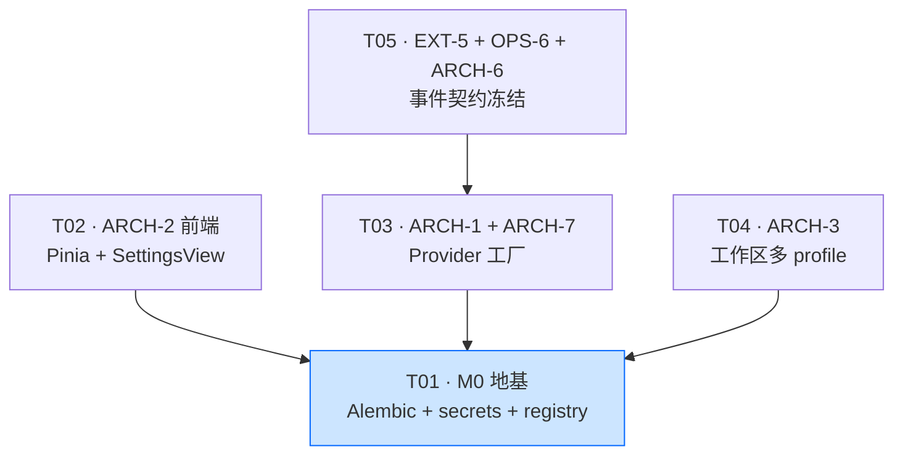

# M0+M1 实施拆分方案（ARCH-1/2/3 + OPS-1/2 + ARCH-6/7/EXT-5/OPS-6 协议冻结）

> 角色：架构师（高见远） · 受众：主理人齐活林 · 输出日期：2025
> 输入：4 份改造文档（20/21/24/27）+ 项目现状勘察
> 目标：把 M0+M1（含"改造前必须定稿"的 ARCH-6/7、EXT-5、OPS-6 协议）拆成 5 个**低冲突、可并行、可独立验收**的子任务，并指明串行化方案

---

## 0. 关键现状（已勘察过的事实）

| # | 现状 | 含义 |
| --- | --- | --- |
| 1 | `agents/rag_agent.py:46/103` 模块级 `InMemorySaver` + `ChatDeepSeek` + `agent` 单例 | 必须抽工厂、被 ARCH-7 scope 改写 |
| 2 | `chat_controller.py:103` 直接 `from app.agents.rag_agent import agent, checkpointer, model` | ARCH-1 完成后必须改 import；setter 改用 `get_agent()` |
| 3 | `services/setting_service.py` 只有 `get/set_workspace_roots`（key="workspace_roots"） | 需扩展成通用 key/value 服务 + 工作区多 profile |
| 4 | `controllers/setting_controller.py` 只有 `/settings/workspace` 两个接口 | 需扩展为 `/settings`、`/settings/meta`、`/settings/secrets/*`、`/settings/workspaces`、`/llm/probe` |
| 5 | `entity/app_setting.py` 是单表 `app_settings(key, value)` | 沿用，加 Alembic 迁移首版 |
| 6 | `tools/tool_utils.py` 模块级 `WORKSPACE_ROOTS = []` 常量 + `path_decision()` 接受 roots 入参 | 切换到"读 active workspace 根"，但保留模块级变量兜底 |
| 7 | `tools/session.py` 的 `current_context()` 已从 setting_service 读 roots | 改读 active 工作区即可，无需改 ContextVar |
| 8 | `db/db_config.py` `Base.metadata.create_all()` + WAL + `check_same_thread=False` | 满足 SqliteSaver 复用，可加 Alembic 平行基线 |
| 9 | `pyproject.toml` 已有 `langchain-deepseek`，**未装** openai/anthropic/google/ollama 包装；无 `keyring`/`cryptography`/`tiktoken`/`alembic` | ARCH-1 + OPS-2 + ARCH-5 各需加依赖（分批装） |
| 10 | 前端无 Pinia；`App.vue` 是顶部导航单栏壳；`router` 用 hash；`main.ts` 一次性注册 Vant 组件 | UX-1 在 M2 做，本次只加 Pinia + 设置页 + 工作区选择器 |
| 11 | `frontend/src/services/` 已有 http/request/chat/scan/audit 封装 + `types.ts`（仅 HealthData） | 新增 `services/settings.ts` 与 types 扩展 |
| 12 | `pyproject.toml` 没有 `app.entity.models.Base`（在 `entity/models.py`，**独立 Base**），`db_config.init_db` 双重 `create_all` | Alembic 必须分别挂两个 Base（`app.db.db_config.Base` 与 `app.entity.models.Base`） |
| 13 | `tools/policy.py` `SessionContext` 已含 `workspace_roots`；`SessionContext` 是 dataclass | ARCH-7 加 `scope` 字段兼容旧调用 |
| 14 | `frontend/src/services/chat.ts` 事件类型已较完整（`ToolEndEvent { name, output }`、`DoneEvent { ... files? }`） | T05 扩展 `ToolEndEvent`（加 total_chars/truncated）、`DoneEvent`（加 usage/subtasks/steer_count/model）、新增 `SteerAcceptedEvent`/`SteerInjectedEvent` 类型 |
| 15 | `electron/src/preload/index.ts` 已暴露 `selectFolder/showItemInFolder/openPath` | ARCH-3 工作区目录选择用现有 `selectFolder` 即可，**不需要动 electron**（本次） |
| 16 | `AGENTS.md` 硬性三条 + `pnpm run test:backend` + `pnpm run typecheck` 必须通过 | 所有任务验收必须跑这两条 |

---

## 1. 本次实施范围

### 1.1 必做（M0+M1 + 协议冻结）

| 模块 | 内容 | 交付里程碑 |
| --- | --- | --- |
| **OPS-1** | Alembic 接入 + 现有 schema 冻结为 `0001_initial` + 新库走 `alembic upgrade head`、旧库走幂等迁移 | M0 |
| **OPS-2** | `services/secrets.py`（keyring + Fernet 降级）；密钥不落 `app.db`；GET 脱敏 | M1 |
| **OPS-6 协议冻结** | `tool_end`/`done`/`confirm_required` 字段契约一次定全（数据表 M5 再建） | M0/M2 冻结，本次只占位 + 类型补齐 |
| **ARCH-2** | 通用设置存储 + `SETTING_DEFS` 注册表 + meta/secrets 接口 + 前端 Pinia store + 设置页骨架 | M1 |
| **ARCH-3** | 多工作区 profile（`workspaces` JSON）+ active 切换 + 工具白名单读 active 根 + WorkspacePicker | M1 |
| **ARCH-1** | Provider 抽象（deepseek/openai/anthropic/google/ollama + 自定义）+ 内置模型清单（含 `context_window`/`supports_tools`/`price_*`）+ `llm.custom_models`/`llm.custom_providers` + 连通测试 `/llm/probe` + `done.model` 字段 | M1 |
| **ARCH-7 预留** | `get_agent(scope: AgentScope)` 工厂签名 + `AgentScope` 枚举 + `SessionContext.scope` 字段 + SUB 强制 ASK 分支（默认 OFF） | M1（与 ARCH-1 同批） |
| **ARCH-6 协议冻结** | `steer_accepted`/`steer_injected` SSE 事件 + `agent.steering_enabled` 设置键 + 前端类型占位；**M2 前端按协议一次做对** | M1 末冻结 |
| **EXT-5 输出契约** | `tools/output_contract.py` 统一截断 + 续读引用 + `tool_end.total_chars/truncated` 字段 | M1 |

### 1.2 不做（明确范围外）

| 模块 | 范围外理由 | 何时做 |
| --- | --- | --- |
| ARCH-4（SqliteSaver 替换 InMemorySaver） | 需要 ARCH-2/ARCH-1 全部跑通再换 checkpointer，独立性强但与本次并发会引入回归 | **M3** 单独批次 |
| ARCH-5（上下文压缩） | 依赖 tiktoken，且要先跑稳 ARCH-1 多 provider | **M3** |
| UX-1（三栏重构）/ UX-2（主题）/ UX-3（Markdown） | 体验主线，独立于能力主线 | **M2** |
| EXT-1/2（Skill/MCP） | 依赖 ARCH-3 + ARCH-1，但本身是大块 | **M4** |
| MEM 工作空间记忆 | 独立 | **M4.5** |
| TASK 复杂任务拆分 | 独立 | **M4.6** |
| OPS-3 日志诊断导出 | 与本批独立 | **M5** |
| OPS-4 自动更新 | Electron 端 | **M5** |
| OPS-5 导入导出 | 依赖 ARCH-2 settings 完整 | **M5** |
| B1~B10 增补 | 2.0 | 按需后置 |

---

## 2. 技术决策清单（关键选型，含理由）

### 2.1 前端状态层：引入 Pinia（P0 推荐）

- **决策**：引入 `pinia@^2.2.0`（与 vue 3.5 兼容）。
- **理由**：ARCH-2 设置页 + 工作区选择器 + M2 主题/M3 会话管理都强需要状态层；不引 Pinia 会回到 `provide/inject` + 多 ref 散落模式，跨页面工作区切换的体验会卡。
- **代价**：`frontend/package.json` 改 + `pnpm install`；`main.ts` 加 `app.use(createPinia())`；与"AGENTS.md 不改业务逻辑"不冲突（新增依赖 = 基础设施）。

### 2.2 Provider 抽象：手写各 provider 工厂 + 底层走 LangChain `BaseChatModel`（P0 推荐，**不用 init_chat_model**）

- **决策**：在 `backend/app/llm/factory.py` 手写 `build_chat_model(provider_id, model, api_key, base_url, **kwargs) -> BaseChatModel`，按 provider 派发到对应 LangChain 类。
- **理由**：
  1. `init_chat_model` 用字符串 provider 名（`"openai"`/`"anthropic"` 等），需要 langchain 生态里的"模型注册器"——对自定义端点/自定义模型支持较弱；
  2. 本项目要支持 `llm.custom_providers`（多 OpenAI 兼容端点并存），手写分支更直接；
  3. 自定义模型元数据（`context_window`/`supports_tools`/`price_*`）需要我们自己维护一张表，挂在 `llm/registry.py`；
  4. 每个 provider 一个 `if/elif` 分支，新增一个端点的成本可控（≈30 行）。
- **依赖分批装**（T03 一次性装齐）：
  ```
  "langchain-openai>=0.2.0",
  "langchain-anthropic>=0.3.0",
  "langchain-google-genai>=2.0.0",
  "langchain-ollama>=0.2.0",
  "langgraph-checkpoint-sqlite>=2.0.0"  # ARCH-4 提前备好但不切换
  ```

### 2.3 SqliteSaver：装依赖但 M1 不切换（P1 推荐）

- **决策**：T03 把 `langgraph-checkpoint-sqlite` 装上，但 `rag_agent.py` 仍用 `InMemorySaver`；ARCH-4（M3）单独批次切 SqliteSaver。
- **理由**：避免 M1 同时改 checkpointer 引入回归（test_chat_confirm 与 test_agent_tools 大量 mock checkpointer）；SqliteSaver 与现有 `app.db` 共存技术可行，**先装先验证可装上**。

### 2.4 密钥存储：keyring 优先 + Fernet 降级（P0 推荐）

- **决策**：`services/secrets.py` 实现两套后端，统一 4 个函数：`get_secret / set_secret / delete_secret / has_secret / describe_secret(返回脱敏元数据)`；keyring 不可用自动降级到 Fernet；Fernet 密钥文件放应用数据目录（0600）。
- **理由**：ARCH-2 已定；降级方案要在同一文件集中实现。

### 2.5 Alembic 与 `create_all` 共存策略（P1 推荐）

- **决策**：
  1. 新增 `backend/alembic.ini` + `backend/migrations/`（env.py 同时挂两个 Base：`app.db.db_config.Base` 与 `app.entity.models.Base`）；
  2. `0001_initial` 用 `Base.metadata` autogenerate + 人工核对；
  3. `init_db()` **保留**，但 `main.py` 启动顺序改为：先 `init_db()` 兜底（已存在的库无破坏），再 `alembic upgrade head` 走迁移；
  4. CI/开发第一次跑：新库 = alembic 直接建（跳过 create_all）；老库 = alembic detect schema 已存在的部分版本号，从下一版继续。
- **理由**：避免 alembic 把已存在的库当成"全新库"重建、丢数据。

### 2.6 SETTING_DEFS 数据类设计（P0 推荐）

```python
# backend/app/services/settings_registry.py
from dataclasses import dataclass, field
from typing import Any, Literal, Callable

@dataclass(frozen=True)
class SettingDef:
    """单条设置声明（无业务逻辑，只有元数据）。"""
    key: str                                   # "llm.provider"，组.键 命名空间，全局唯一
    type: Literal["bool","int","float","string","json","select"]  # 类型开关
    default: Any                               # 落库前用此值；调用方不用 if-else 兜底
    category: str                              # 设置页分组：agent/context/cost/model/advanced/theme/workspaces/tools
    description: str                           # 文档注释
    min: float | None = None                   # 数值范围下限
    max: float | None = None
    options: tuple[Any, ...] = ()              # select 可选值
    secret: bool = False                       # 是否走钥匙串（仅占位；密钥真实存储走 services.secrets）
    since: str = "M0"                          # 首次引入里程碑
    validate: Callable[[Any], str | None] | None = None  # 自定义校验，返 None 或错误文案

# 全局注册表：模块启动期 import 各包 SETTING_DEFS 后聚合
_REGISTRY: dict[str, SettingDef] = {}

def register(defs: list[SettingDef]) -> None: ...
def get_meta() -> list[dict]: ...               # GET /api/settings/meta 返回
def get_setting(key: str) -> Any: ...            # 落库值 ? 声明默认值
def put_settings(partial: dict[str, Any]) -> dict[str, Any]: ...  # 校验 → 落库 → publish

# pub/sub：按 key 前缀订阅
_subscribers: dict[str, list[Callable[[str, Any], None]]] = {}
def subscribe(prefix: str, cb: Callable[[str, Any], None]) -> Callable[[], None]: ...
def publish(key: str, value: Any) -> None: ...
```

- **变更通知**：`llm/state.py` 订阅 `llm.*` / `model.*`（重建 agent）；T02 前端 store 订阅 `*`（刷新视图）。
- **前端**：Pinia store 启动拉 `GET /api/settings` + `GET /api/settings/meta`，按 `category` 自动分组渲染。

---

## 3. 文件级数据契约（防冲突的"宪法"）

下面这些数据结构**所有任务必须严格遵守**。任何越界请先回本节修改。

### 3.1 设置键名全集（M1 第一版，对齐 `27-设置体系规范.md` §5）

| 键 | 类型 | 默认 | category | 说明 |
| --- | --- | --- | --- | --- |
| `llm.provider` | select | `deepseek` | model | 内置 provider id |
| `llm.model` | string | `deepseek-chat` | model | 内置/自定义模型名 |
| `llm.base_url` | string | `` | model | 内置 openai 的 base_url（其它 provider 留空） |
| `llm.temperature` | float | `0.0` | model | 0~2 |
| `llm.max_tokens` | int | `0` | model | 0=不传 |
| `llm.custom_models` | json | `[]` | model | 自定义模型清单 |
| `llm.custom_providers` | json | `[]` | model | 自定义 OpenAI 兼容端点 |
| `secrets.<provider>.api_key` | string (secret) | — | (单独走 secrets API) | 钥匙串存储，不走表 |
| `embedding.base_url` | string | `https://api.siliconflow.cn/v1` | advanced | 由 config.py 迁移 |
| `embedding.model` | string | `BAAI/bge-m3` | advanced | |
| `embedding.dim` | int | `1024` | advanced | |
| `tools.allow_web` | bool | `false` | tools | 替代 `settings.allow_web_tools`（env） |
| `workspaces` | json | `[]` | workspaces | 工作区列表（ARCH-3） |
| `workspaces.active_id` | string | `` | workspaces | 当前生效工作区 id |
| `theme` | json | `{}` | theme | 预留 UX-2 |
| `agent.max_iterations` | int | `25` | agent | 已有，迁入 SETTING_DEFS |
| `agent.steering_enabled` | bool | `true` | agent | ARCH-6 |
| `agent.subagent_enabled` | bool | `false` | agent | ARCH-7（首版关） |
| `agent.subagent_max_parallel` | int | `2` | agent | ARCH-7 |
| `context.max_tool_output_chars` | int | `8000` | context | EXT-5 |
| `context.tool_output_truncate` | bool | `true` | context | EXT-5 |
| `trace.enabled` | bool | `true` | advanced | OPS-6（事件契约冻结 + M5 落库） |

### 3.2 Provider 描述结构（`llm/registry.py`）

```python
@dataclass(frozen=True)
class ModelSpec:
    model: str                  # 模型名，API 调用用
    label: str                  # 展示名
    context_window: int         # token 上限（ARCH-5 压缩阈值分母）
    supports_tools: bool = True
    supports_vision: bool = False
    price_in: float = 0.0       # 元/百万 token（UX-5 用）
    price_out: float = 0.0

@dataclass(frozen=True)
class ProviderSpec:
    id: str                     # "deepseek"/"openai"/.../"custom-<id>"
    label: str
    env_key: str                # 内置 key 名（仅提示用），如 "DEEPSEEK_API_KEY"；custom-* 走 secrets
    base_url: str | None = None # 内置 openai 的默认 base_url
    models: tuple[ModelSpec, ...] = ()
    protocol: Literal["deepseek","openai","anthropic","google","ollama"] = "openai"
    custom: bool = False        # True 表示来自 llm.custom_providers
```

### 3.3 自定义模型/Provider JSON 结构（落 `app_settings.value`）

```jsonc
// llm.custom_models 项（按 provider+model 合并去重）
{
  "provider": "openai",                  // 必填
  "model": "gpt-4o-mini",                // 必填，匹配 ProviderSpec 的 model 字段
  "label": "GPT-4o mini (私有)",
  "context_window": 128000,
  "supports_tools": true,
  "price_in": 0.15,
  "price_out": 0.60
}

// llm.custom_providers 项
{
  "id": "sf",                            // 全局唯一（前端把 "custom-" 前缀拼上）
  "label": "硅基流动",
  "base_url": "https://api.siliconflow.cn/v1",
  "protocol": "openai",                  // 首版仅 openai 兼容
  "api_key_secret": "custom.foxlynx.api_key"   // 对应钥匙串的键
}
```

### 3.4 工作区结构（`workspaces` + `workspaces.active_id`）

```jsonc
// app_settings.key="workspaces" value = JSON.stringify([...])
[
  {
    "id": "w-1",                          // uuid4 字符串
    "name": "主项目",                      // 展示名
    "roots": ["D:\\work\\app"],           // 根目录绝对路径列表；空数组表示「不限制」
    "active": true                        // 首版为「唯一真相源」：列表里 active=true 的就是当前 active
  },
  { "id": "w-2", "name": "学习笔记", "roots": ["D:\\notes"], "active": false }
]

// app_settings.key="workspaces.active_id" value = "w-1"   // 冗余存储，便于单字段读取
```

> 升级路径：首启迁移把旧 `workspace_roots` 列表读出来 → 生成一个默认工作区 `{id="default", name="默认", roots=[...], active=true}` → 同时写入 `workspaces` 与 `workspaces.active_id`。

### 3.5 SSE 事件契约（M1 末冻结，**T05 一次性定全**）

```python
# 后端 app/schemas/chat_events.py（T05 新增）
class ToolEndEvent(BaseModel):
    name: str
    output: str
    total_chars: int = 0           # EXT-5：原始输出字符数（未截断时）
    truncated: bool = False        # EXT-5：是否被截断
    continuation_ref: str | None = None   # EXT-5：续读引用 key（前缀 "tool-out-"，存 app_settings）
    model: str | None = None       # ARCH-1：本轮使用的 "provider/model"，便于按轮计费与回放

class DoneEvent(BaseModel):
    session_id: str
    answer: str
    elapsed: float
    tool_calls: list[dict]
    history_len: int
    files: list[dict] = []
    # ---- M1 末冻结字段 ----
    usage: dict | None = None          # {"prompt_tokens":N,"completion_tokens":N,"total_tokens":N}
    subtasks: list[dict] | None = None # TASK 预留
    steer_count: int = 0               # ARCH-6：本轮被 steer 次数
    model: str | None = None           # ARCH-1：本轮最终使用的 "provider/model"

class SteerAcceptedEvent(BaseModel):
    queued: bool

class SteerInjectedEvent(BaseModel):
    content: str                       # 注入模型上下文的那段文本
    at_step: int                       # 第几步注入（用于回放）
```

### 3.6 设置 API 契约（T01+T02 唯一新增）

| 方法 | 路径 | 入参 | 出参 | 说明 |
| --- | --- | --- | --- | --- |
| GET | `/api/settings` | — | `{ [key: string]: { value, masked?, has_value? } }` | 全量；密钥只回 `masked="sk-****abcd"` 与 `has_value=true/false` |
| GET | `/api/settings/meta` | — | `SettingDef[]`（JSON 数组，字段名见 3.1） | 不含任何值 |
| PUT | `/api/settings` | `{ [key: string]: value }` | 同 GET | 按声明逐键校验；非法键整体 400 |
| GET | `/api/settings/{key}` | — | 单条同 GET | |
| PUT | `/api/settings/{key}` | `{ value }` | 单条同 GET | |
| PUT | `/api/settings/secrets/{key}` | `{ value: string }` | `{ masked, has_value: true }` | 密钥只进不出 |
| DELETE | `/api/settings/secrets/{key}` | — | `{ deleted: true }` | |
| GET | `/api/settings/secrets` | — | `{ [key]: { masked, has_value } }` | 元数据列表 |
| GET | `/api/settings/workspaces` | — | `{ workspaces: Workspace[], active_id: str }` | |
| POST | `/api/settings/workspaces` | `{ name, roots }` | `Workspace` | 创建；返回完整对象（分配 id） |
| PUT | `/api/settings/workspaces/{id}` | `{ name?, roots? }` | `Workspace` | 重命名/改根 |
| DELETE | `/api/settings/workspaces/{id}` | — | `{ deleted }` | |
| POST | `/api/settings/workspaces/active` | `{ id }` | `{ active_id }` | 切换；发布 `workspaces.active_id` 变更 |
| POST | `/api/llm/probe` | `{ provider, model, base_url? }` | `{ ok, latency_ms, error? }` | 连通测试；密钥从钥匙串取 |

```python
class Workspace(BaseModel):
    id: str
    name: str
    roots: list[str]
    active: bool
```

---

## 4. 共享文件冲突点与串行化方案

> **核心原则**：先做地基（T01），再让两个修改者并行（T02 前端 / T03 后端），T04 与 T05 在 T03 之上串行。

### 4.1 冲突点清单

| 文件 | 谁要改 | 改什么 | 风险 |
| --- | --- | --- | --- |
| `backend/app/agents/rag_agent.py` | T03（必） + T05（必） | T03 改 `import` + 去模块级单例；T05 调 `tool_end` 序列化 + 注入 `output_contract` | **必须串行：T03 先交，T05 再动** |
| `backend/app/controllers/chat_controller.py` | T03（改 import / 取消模块级 model 引用） + T05（事件 schema 扩展 + steer hook 占位） | T03 改 `from app.agents.rag_agent import agent, model` → `get_agent()` + 改 `_seed_messages`/msg 注入；T05 改 SSE 序列化 | **必须串行：T03 先交，T05 再动** |
| `backend/app/services/setting_service.py` | T01（重构通用化） + T04（加工作区 CRUD） | T01 把现有函数保留 + 加通用 get/put/get_all；T04 加 `workspaces_service.py`（**新建**而不是塞 setting_service） | **通过"新建子服务"隔离** |
| `backend/app/controllers/setting_controller.py` | T01（扩展接口） + T04（加 /workspaces/*） | T01 在原文件加 `/settings` `/settings/meta` `/settings/secrets/*` `/settings/{key}`；T04 新建 `controllers/workspace_controller.py` 并在 `api/router.py` 挂载 | **通过"新建 controller"隔离** |
| `backend/app/api/router.py` | T01（加 settings_router） + T04（挂 workspace_router） | 都是追加行，**不冲突** | — |
| `backend/app/tools/policy.py` | T03（ARCH-7 加 `SessionContext.scope` 字段） + 现有不动 | T03 仅在 dataclass 末尾加一字段；兼容默认值 | **可独立**，T03 单点改 |
| `backend/app/tools/session.py` | T04（`current_context()` 改读 active workspace 根） | 仅替换读 roots 的逻辑 | T04 单点改 |
| `backend/app/tools/tool_utils.py` | T05（`output_contract` 接入截断；不改 `path_decision`） | 新增 `tools/output_contract.py`，在 `tools/__init__.py` 导出；不直接改 tool_utils | **通过"新建文件"隔离** |
| `backend/app/main.py` | T01（启动加 `alembic upgrade head`） + T03/T04（无改动） | T01 单点改 | — |
| `backend/pyproject.toml` | T01（加 alembic/keyring/cryptography/tiktoken） + T03（加 4 个 langchain-*） | 分两批装：T01 一批，T03 一批 | **按任务边界分批** |
| `frontend/package.json` | T02（加 pinia） | 单次改 | — |
| `frontend/src/main.ts` | T02（加 `app.use(createPinia())`） | 单点改 | — |
| `frontend/src/services/index.ts` | T02（导出 settings 模块） | 单点改 | — |
| `frontend/src/services/types.ts` | T02（扩展 Settings 类型） + T05（扩展 chat 事件类型） | 都是追加；**T05 在 T02 完成后做** | **通过追加行隔离 + 串行** |
| `frontend/src/router/index.ts` | T02（加 `/settings`） | 单点改 | — |
| `frontend/src/App.vue` | T02（加「设置」导航） + 不动 | 单点改 | — |
| `frontend/src/views/scannHistory.vue` | **不动**（M2 再拆） | — | — |

### 4.2 串行化规则总结

1. **必须按 T01 → T02/T03/T04 → T05 顺序**；
2. T02/T03/T04 都依赖 T01，**三者之间互不读写对方负责的文件**（除 `app/api/router.py` 追加行），可同窗口并行；
3. T05 修改 `chat_controller.py` / `rag_agent.py` / `chat.ts`，必须等 T03 完成 commit 后再开始；
4. **新建文件优先**（`workspaces_service.py` / `workspace_controller.py` / `output_contract.py` / `secrets.py` / `llm/*` / `services/settings_registry.py`），减少对存量文件的修改面。

---

## 5. 子任务拆分（5 个任务，硬上限）

### T01 · M0 地基：Alembic + 通用设置服务 + 密钥服务 + 注册表骨架

**目标**：把后续所有任务的「共享地基」一次性打掉，让 T02/T03/T04 各自只动自己的文件。

**优先级**：P0

**依赖**：无

**独占文件清单（只 T01 写，其它任务不碰）**：

| 动作 | 文件 | 关键内容（精确到可写代码） |
| --- | --- | --- |
| 新增 | `backend/pyproject.toml`（追加依赖） | `"alembic>=1.13.0", "keyring>=25.0.0", "cryptography>=43.0.0"`（T01 装齐这三个，T03 再装 langchain-* 与 tiktoken） |
| 新增 | `backend/alembic.ini` | `script_location = migrations`、`sqlalchemy.url = sqlite:///./app.db`（env.py 里覆盖） |
| 新增 | `backend/migrations/env.py` | `target_metadata = [Base.metadata, RagBase.metadata]`；同步双 Base |
| 新增 | `backend/migrations/versions/0001_initial.py` | `op.create_table(...)` 对 `app_settings` / `chat_sessions` / `chat_messages` / `audit_logs` / `scan_tasks` / `scan_progress` / `scan_results` / `file_info` / `file_kind` / `documents` / `chunks` / `index_meta` 等所有现有表（用 autogenerate + 人工核对） |
| 新增 | `backend/app/services/secrets.py` | 5 个函数：`get_secret(key) -> str \| None`、`set_secret(key, value)`、`delete_secret(key)`、`has_secret(key) -> bool`、`describe_secret(key) -> dict{masked, has_value}`；`mask_value()` 函数（前 2 + 末 4 字符）；`keyring` 不可用 → Fernet 降级（密钥文件 `app_data_dir()/fernet.key`，权限 0600）；`BACKEND` 模块级变量，初始探测后固定；启动期打印降级日志 |
| 新增 | `backend/app/services/settings_registry.py` | `SettingDef` dataclass + 全局 `_REGISTRY`、`_subscribers`；5 个函数：`register(defs)`、`get_meta()`、`get_setting(key)`、`put_settings(partial)`、`subscribe(prefix, cb)`、`publish(key, value)`；首版仅注册以下 3 个键（其它键在各任务里追加）：`tools.allow_web` (bool default false)、`agent.max_iterations` (int default 25, min 1, max 50)、`trace.enabled` (bool default true) |
| 重构 | `backend/app/services/setting_service.py` | **保留** `get_workspace_roots/set_workspace_roots`（旧接口，T04 替换为 workspaces_service）；**新增**通用 `get_setting(key) -> Any`、`set_setting(key, value) -> Any`、`get_all_settings() -> dict`、`mask_settings_dict(d) -> dict`（把密钥键自动脱敏）。**约束**：旧函数签名不变，调用方零修改 |
| 新增 | `backend/app/schemas/setting.py` | `SettingDefSchema`、`SettingUpdate`、`SettingItem`、`WorkspacesUpdate`（仅占位，T04 实现实体） |
| 新增 | `backend/app/controllers/secrets_controller.py` | 路由：`PUT /api/settings/secrets/{key}`、`DELETE /api/settings/secrets/{key}`、`GET /api/settings/secrets`；转调 `services.secrets` |
| 扩展 | `backend/app/controllers/setting_controller.py` | **新增**（保留旧 `/workspace`）`GET /api/settings`、`GET /api/settings/meta`、`PUT /api/settings`、`GET /api/settings/{key}`、`PUT /api/settings/{key}`；处理：返回前统一 `mask_settings_dict`；写入走 `put_settings` |
| 修改 | `backend/app/main.py` | 启动顺序改为：`init_db()` → `alembic_cfg = alembic.config.Config("alembic.ini")` → `command.upgrade(alembic_cfg, "head")`（用 try/except 容忍老库已存在版本表的情况：探测 `alembic_version` 表，无则升级、有则跳过） |
| 修改 | `backend/app/api/router.py` | 追加 `api_router.include_router(secrets_controller.router)` 一行 |

**独占边界（明确「不碰」）**：
- 不动 `agents/rag_agent.py`、`controllers/chat_controller.py`、`tools/*`（除 import `Base` 用基类别名外）；
- 不动 `entity/workspace.py`（T04 新建）；
- 不动前端任何文件。

**验收标准**（可执行）：

1. `cd backend && uv sync` 成功，新增 3 个依赖装齐；
2. `cd backend && uv run alembic upgrade head` 在新库（删 app.db 后）能建出与 `create_all` 等价的全部表；
3. `cd backend && uv run pytest` 全绿（含现有 `test_chat_confirm` / `test_agent_tools` / `test_health` / `test_tools` / `test_chat_history`）；
4. `curl http://127.0.0.1:8000/api/settings` 返回 `{}` 或仅包含 3 个默认键；
5. `curl http://127.0.0.1:8000/api/settings/meta` 返回 `SettingDef` JSON 数组（≥3 条）；
6. `curl -X PUT http://127.0.0.1:8000/api/settings/secrets/deepseek.api_key -H 'Content-Type: application/json' -d '{"value":"sk-test-1234abcd"}'` → 返回 `{"masked":"sk-****abcd","has_value":true}`；
7. `sqlite3 app.db ".dump app_settings"` 查不到任何明文密钥；
8. `pnpm run typecheck` 通过（前端未动也应通过）。

---

### T02 · ARCH-2 设置可视化（前端 + Pinia）

**目标**：前端能改、能查设置；密钥走单独的 put/delete 接口，**永远不回显明文**。

**优先级**：P0

**依赖**：T01

**独占文件清单**：

| 动作 | 文件 | 关键内容 |
| --- | --- | --- |
| 修改 | `frontend/package.json` | 加 `"pinia": "^2.2.0"`（devDependencies 不需要） |
| 修改 | `frontend/src/main.ts` | 在 `createApp(App).use(router)` 之后加 `.use(createPinia())`；新 import |
| 新增 | `frontend/src/services/settings.ts` | `fetch_settings()` → `Promise<SettingsMap>`；`fetch_settings_meta()` → `Promise<SettingDef[]>`；`put_settings(partial)`；`get_setting(key)`；`put_secret(key, value)`；`delete_secret(key)`；`list_secrets()`；`probe_llm({provider, model, base_url?})`；类型与 §3.1/§3.6 一致 |
| 扩展 | `frontend/src/services/types.ts` | 追加 `SettingDef` / `SettingItem` / `SecretMeta` / `Workspace` / `WorkspacesResponse` / `LlmProbeRequest` / `LlmProbeResponse` 类型 |
| 修改 | `frontend/src/services/index.ts` | 追加 `export * from './settings'`（仅导出新增公开 API，不动既有） |
| 新增 | `frontend/src/stores/settings.ts` | Pinia store：`state = { values, meta, loaded }`；`actions = { load(), get(key), put(partial), putSecret(key, value), deleteSecret(key) }`；**订阅后端**走 SSE 不在 M1 范围（M2 主题/工作区同步才需要），本期仅启动拉一次 |
| 新增 | `frontend/src/stores/workspaces.ts` | Pinia store：`state = { list, activeId }`；`actions = { load(), create(), update(id, partial), remove(id), setActive(id) }` |
| 新增 | `frontend/src/views/SettingsView.vue` | 按 `category` 分区渲染（v-for `meta`）；每区用 `<SectionCard>` 子组件；模型区含「测试」按钮调 `/llm/probe`；密钥区单独走 `put_secret`/`delete_secret`；提交走 `put(partial)` |
| 新增 | `frontend/src/components/settings/SectionCard.vue` | 单分区壳（标题 + 描述 + 槽位） |
| 新增 | `frontend/src/components/settings/FieldRenderer.vue` | 按 `type` 渲染（bool→van-switch、int/float→van-stepper、string→van-field、select→van-dropdown_item、json→van-field textarea + 校验） |
| 新增 | `frontend/src/components/WorkspacePicker.vue` | 顶部下拉 + 侧边栏入口；调 `stores/workspaces.ts`；选中触发 `setActive` |
| 修改 | `frontend/src/router/index.ts` | 追加 `{ path:'/settings', name:'settings', component:()=>import('@/views/SettingsView.vue'), meta:{title:'设置'} }` |
| 修改 | `frontend/src/App.vue` | 在 `<nav class="nav">` 里追加 `<RouterLink to="/settings">设置</RouterLink>`（不动其它结构） |
| 修改 | `frontend/src/views/HomeView.vue` | **可选**：在首页加一行「打开设置」快捷入口（最小改动） |

**独占边界（明确「不碰」）**：
- 不动 `services/chat.ts` 既有事件类型（T05 才扩）；
- 不动 `views/scannHistory.vue`；
- 不动后端任何文件（T04 独占 workspace_controller.py，不属于 T02）；
- 不写 Pinia 持久化插件（启动拉一次即可，M2 再考虑持久化）；
- 不引入 Pinia plugin persistence。

**验收标准**：

1. `pnpm install` 装上 pinia，`pnpm run typecheck` 通过；
2. 浏览器访问 `/#/settings`，能看到「模型」「上下文」「工作区」「高级」等分区（至少 3 个 category）；
3. 改 `llm.provider` 后点保存 → 调 `PUT /api/settings` → 再 `GET /api/settings` 能看到新值；
4. 模型区「测试」按钮 → 调 `/api/llm/probe` → 显示 `{ok:false,error:'密钥未配置'}` 或 `{ok:true,latency_ms:N}`（注意：`/llm/probe` 接口由 T03 提供，T02 先写客户端调用代码 + mock 兜底：探测 404 时前端友好提示「请等待后端就绪」）；
5. 设置 `secrets.deepseek.api_key = "sk-test-1234abcd"` → 列表显示 `sk-****abcd`，刷新后仍存在，DB 查不到明文；
6. 「工作区」区可新增/重命名/删除工作区（**T04 真正接管数据**，T02 用一个本地 mock 数据兜底：`stores/workspaces.ts` 启动时若 `/api/settings/workspaces` 返回 404 则进入 mock 模式）；
7. 切换 active 工作区后，前端 `WorkspacePicker` 立即反映。

---

### T03 · ARCH-1 Provider 抽象 + ARCH-7 子 agent 工厂签名 + chat_controller 切换

**目标**：把硬编码 `ChatDeepSeek` 换成多 Provider；`get_agent(scope)` 工厂签名一次做对；chat_controller 切到工厂。

**优先级**：P0

**依赖**：T01

**独占文件清单**：

| 动作 | 文件 | 关键内容 |
| --- | --- | --- |
| 修改 | `backend/pyproject.toml` | 加 `"langchain-openai>=0.2.0", "langchain-anthropic>=0.3.0", "langchain-google-genai>=2.0.0", "langchain-ollama>=0.2.0", "tiktoken>=0.8.0"`（tiktoken 给 ARCH-5 备料；M3 用） |
| 新增 | `backend/app/llm/__init__.py` | 包说明 + 导出 `get_agent`、`ProviderSpec`、`ModelSpec`、`AgentScope` |
| 新增 | `backend/app/llm/registry.py` | `BUILTIN_PROVIDERS: dict[str, ProviderSpec]`（deepseek/openai/anthropic/google/ollama），每家附 `models: tuple[ModelSpec,...]`（deepseek: `deepseek-chat` `deepseek-reasoner`；openai: `gpt-4o-mini` `gpt-4o` `o3-mini`；anthropic: `claude-3-5-sonnet-latest` `claude-3-5-haiku-latest`；google: `gemini-1.5-pro` `gemini-1.5-flash`；ollama: `llama3.1` `qwen2.5`）；`merge_custom_providers()`、`merge_custom_models()`、`resolve_spec(provider_id) -> ProviderSpec \| None` |
| 新增 | `backend/app/llm/factory.py` | `build_chat_model(provider, model_name, api_key, base_url=None, temperature=0.0, max_tokens=0) -> BaseChatModel`；按 `ProviderSpec.protocol` 派发：`deepseek→ChatDeepSeek`、`openai/custom→ChatOpenAI(base_url=...)`、`anthropic→ChatChatAnthropic`、`google→ChatGoogleGenerativeAI`、`ollama→ChatOllama` |
| 新增 | `backend/app/llm/state.py` | 模块级 `_current: dict[str, BaseChatModel]`、`_current_agent: CompiledStateGraph \| None`；`get_agent(scope: AgentScope = AgentScope.MAIN)` 工厂：`MAIN` = 当前签名（system_prompt + TOOLS + checkpointer + 当前 provider/model 实例）；`SUB` = 受限工具集（仅 READ_TOOLS + 裸模型）+ 独立 thread 前缀 `sub:<uuid>`；**设置变更（订阅 `llm.*`/`model.*`）→ `_current.clear()`** |
| 新增 | `backend/app/llm/scope.py` | `enum AgentScope(str, Enum): MAIN = "main"; SUB = "sub"` |
| 新增 | `backend/app/llm/probe.py` | `async def probe_llm(provider, model, base_url=None) -> dict{ok, latency_ms, error?}`：发最小 `ainvoke("ping")`，捕获异常区分"密钥错/模型名错/网络错"；密钥走 `services.secrets.get_secret(f"{provider}.api_key")` 或 `f"custom.{custom_id}.api_key"` |
| 新增 | `backend/app/controllers/llm_controller.py` | 路由：`POST /api/llm/probe`；入参 `LlmProbeRequest{provider, model, base_url?}`；调用 `llm.probe.probe_llm` |
| 修改 | `backend/app/api/router.py` | 追加 `api_router.include_router(llm_controller.router)` 一行 |
| 修改 | `backend/app/services/settings_registry.py`（由 T01 持有） | **T03 不直接改这个文件**——而是在 `backend/app/llm/settings_defs.py` 新建：声明 `SETTING_DEFS`（`llm.provider/model/base_url/temperature/max_tokens/custom_models/custom_providers`），并 `from app.services.settings_registry import register; register(SETTING_DEFS)` 在 `llm/__init__.py` import 时触发 |
| 新增 | `backend/app/llm/settings_defs.py` | 上表 |
| 修改 | `backend/app/agents/rag_agent.py` | **大改**：删模块级 `model = ChatDeepSeek(...)`、`agent = create_agent(...)`；改为：调用 `get_agent(AgentScope.MAIN)`；保留 `TOOLS = ...` / `install_builtin_policies()` / `verify_all_tools_registered(TOOLS)` / `SYSTEM_PROMPT`；**新增** `bare_model()` 返回 `get_agent(AgentScope.MAIN)` 的同名裸模型（不带工具的 `_current` 实例），供 `\doc` 检索一次性总结使用（ARCH-1 验收点） |
| 修改 | `backend/app/controllers/chat_controller.py` | `from app.agents.rag_agent import agent, model, checkpointer` 改为：`from app.agents.rag_agent import get_agent, bare_model, checkpointer`；运行时调用 `agent = get_agent()`、`doc_model = bare_model()`；**取消**模块级缓存的引用；**`_seed_messages`/`needs_reseed` 分支保留**（ARCH-4 单独删，M1 不动） |
| 修改 | `backend/app/tools/policy.py` | `SessionContext` 加字段 `scope: AgentScope = AgentScope.MAIN`；`decide()` 在 `Kind.WRITE` 与 `Kind.EXEC` 路径加一条：`if session.scope is AgentScope.SUB and (action.kind in (Kind.WRITE, Kind.EXEC)): return Level.ASK`（强制 ASK，红线） |
| 修改 | `backend/app/tools/session.py` | `current_context()` 多取 `scope`：从 settings 读 `agent.subagent_enabled` 默认 False → 永远 `MAIN`（首版关闭） |
| 新增 | `backend/tests/test_llm_factory.py` | 单元测试：`build_chat_model("deepseek", "deepseek-chat", "test-key")` 返回 `ChatDeepSeek`；`build_chat_model("custom-xxx", "model", "k", base_url="http://...")` 返回 `ChatOpenAI(base_url=...)`；`resolve_spec("not-exist")` 返回 None |
| 新增 | `backend/tests/test_provider_registry.py` | `BUILTIN_PROVIDERS` 含 5 家；`merge_custom_models([{provider:"openai",model:"gpt-4o-mini",context_window:128000,...}])` 覆盖内置；`merge_custom_providers([{id:"sf",base_url:"...",protocol:"openai"}])` 产出 `custom-sf` |
| 新增 | `backend/tests/test_agent_scope.py` | `SessionContext(scope=SUB)` 对 WRITE 路径返回 ASK（即使 `require_confirm=False`） |
| 修改 | `backend/tests/test_chat_confirm.py` | `monkeypatch` 路径：`monkeypatch.setattr("app.agents.rag_agent.get_agent", lambda scope=MAIN: build_test_agent())` ——把原 `monkeypatch.setattr(chat_controller, "agent", ...)` 适配到新工厂 |

**独占边界（明确「不碰」）**：
- 不动 `tools/output_contract.py`（T05 新建）；
- 不动 `services/setting_service.py` 与 `controllers/setting_controller.py`（T01 改的，T03 不再改）；
- 不动 `controllers/workspace_controller.py`（T04 新建）；
- 不动 `services/workspaces_service.py`（T04 新建）；
- 不动前端任何文件（前端 settings 页面看到 `llm.*` 键会自动出现，不需 T03 改前端）。

**验收标准**：

1. `uv sync` 成功，新增 5 个依赖装齐；
2. `pnpm run test:backend` 全绿（含 3 个新测试 + 现有 `test_chat_confirm` 适配后仍绿）；
3. `pnpm run typecheck` 通过（前端未动）；
4. `from app.llm import get_agent; print(type(get_agent()).__name__)` 在设置 `llm.provider=deepseek` 时返回 LangGraph `CompiledStateGraph`；
5. 切换 `llm.provider=openai`（设置页保存）后立即调用 `get_agent()` → 重新构造（订阅生效，验证：单元测试 `state.test_llm_settings_invalidate`）；
6. `curl -X POST http://127.0.0.1:8000/api/llm/probe -H 'Content-Type: application/json' -d '{"provider":"deepseek","model":"deepseek-chat"}'` 在配置了真实 key 时返回 `{ok:true,latency_ms:N}`；
7. 启动 `chat_controller` 时不再因 `APP_DEEPSEEK_API_KEY` 缺失而崩溃（key 缺失走 `state` 校验并返回明确错误）；
8. 旧 `test_chat_confirm` 的人工确认场景在 `ChatDeepSeek` 替换为 `FakeMessagesListChatModel` 后仍能完整通过。

---

### T04 · ARCH-3 工作区多 profile + 工具白名单切换

**目标**：把扁平 `workspace_roots` 升级为多工作区；工具层读 active 工作区根。

**优先级**：P0

**依赖**：T01

**独占文件清单**：

| 动作 | 文件 | 关键内容 |
| --- | --- | --- |
| 新增 | `backend/app/services/workspaces_service.py` | 5 个函数：`list_workspaces() -> list[Workspace]`、`get_active_workspace() -> Workspace \| None`、`create_workspace(name, roots) -> Workspace`、`update_workspace(id, name?, roots?) -> Workspace`、`delete_workspace(id) -> bool`、`set_active_workspace(id)`；**首启迁移**：`if not list_workspaces():` 读旧 `workspace_roots` → 创建默认工作区 `{id="default", name="默认", roots=..., active=true}`；每次 `set_active` 调用 `settings_registry.publish("workspaces.active_id", id)` |
| 新增 | `backend/app/entity/workspace.py` | `Workspace` Pydantic 模型（id/name/roots/active），**不建表**（沿用 `app_settings` 存 JSON） |
| 新增 | `backend/app/schemas/workspace.py` | `WorkspaceCreate`、`WorkspaceUpdate`、`WorkspaceActiveRequest`、`WorkspacesResponse`（对齐 §3.6） |
| 新增 | `backend/app/controllers/workspace_controller.py` | 路由：`GET /api/settings/workspaces`、`POST /api/settings/workspaces`、`PUT /api/settings/workspaces/{id}`、`DELETE /api/settings/workspaces/{id}`、`POST /api/settings/workspaces/active` |
| 修改 | `backend/app/api/router.py` | 追加 `api_router.include_router(workspace_controller.router)` 一行 |
| 修改 | `backend/app/services/setting_service.py` | 旧 `get_workspace_roots/set_workspace_roots` 标 `@deprecated`，内部直接调用 `workspaces_service`；**保留旧 API 路径**（chat_history 等若有依赖，零回归） |
| 修改 | `backend/app/services/settings_registry.py`（T01 持有） | **T04 不直接改**——在 `backend/app/services/workspaces_settings_defs.py` 新建：声明 `SETTING_DEFS = [SettingDef(key="workspaces.active_id", ...), SettingDef(key="workspaces", type="json", ...)]`；`from app.services.settings_registry import register; register(SETTING_DEFS)` |
| 修改 | `backend/app/tools/session.py` | `current_context()` 改读：`roots = tuple(workspaces_service.get_active_workspace().roots) if workspaces_service.get_active_workspace() else ()` |
| 修改 | `backend/app/tools/tool_utils.py` | `WORKSPACE_ROOTS` 模块级常量**保留作为兜底**（设置未就绪/active 为空时 fallback 到 `()` 表示不限制——保留现状行为）；不直接改 `path_decision`（已接受 roots 入参） |
| 新增 | `backend/app/llm/state.py` 联动 | T03 已经有 `state.py`；T04 不直接改；通过订阅 `workspaces.active_id` 由 state 在变化时把 `_current_agent` 标记 stale（订阅回调：`def on_ws_change(key, val): _current.pop("agent", None)`）——这点由 T03 在 `state.py` 显式订阅，T04 不再订阅 |
| 新增 | `backend/tests/test_workspaces.py` | 单元测试：迁移（首启从旧 `workspace_roots` 读出）；CRUD；active 切换；`current_context()` 在 active 切换后读到新根；删除最后一个工作区时 `active_id` 清空 |
| 修改 | `frontend/src/stores/workspaces.ts` | T02 已有；T04 删除 T02 的 mock fallback（`/api/settings/workspaces` 现在真存在），改用真实接口 |

**独占边界（明确「不碰」）**：
- 不动 `controllers/chat_controller.py` / `agents/rag_agent.py`；
- 不动 `llm/factory.py` / `llm/registry.py`（ARCH-1 是 T03）；
- 不动 `frontend/src/views/SettingsView.vue` 的设置区（T02 已搭好壳，T04 接管「工作区」面板的 wire-up 部分）；
- 不动 `frontend/src/components/WorkspacePicker.vue` 的视觉（T02 写好的，T04 只换数据源）。

**验收标准**：

1. `pnpm run test:backend` 全绿（含新测试）；
2. `pnpm run typecheck` 通过；
3. `curl -X POST http://127.0.0.1:8000/api/settings/workspaces -H 'Content-Type: application/json' -d '{"name":"测试","roots":["D:\\test"]}'` 返回完整 Workspace 对象；
4. `curl -X POST http://127.0.0.1:8000/api/settings/workspaces/active -H 'Content-Type: application/json' -d '{"id":"<id>"}'` 返回 `{active_id:"<id>"}`；
5. 旧库（已有 `workspace_roots`）启动后，自动创建一个默认工作区，列表查询返回 1 条；
6. 切换 active 后，前端 `WorkspacePicker.vue` 立即刷新（验证 store 订阅）；
7. 单元测试 `test_current_context_reads_active` 证明：调用 `set_session_id(sid)` 后 `current_context().workspace_roots` 等于 active 工作区的 roots。

---

### T05 · EXT-5 输出契约 + OPS-6 事件契约冻结 + ARCH-6 steer 协议契约

> **补记（M2）**：T05 在 M1 阶段只完成了协议设计与文档，代码未落地（`output_contract.py` 当时并不存在）。
> M2 已按本文约定补齐，并做了一处必要修订：**截断不放在 `tool_utils.py`，而是放在 `policy.make_tool` 的统一出口**
> （因为 `make_tool` 是所有注册工具的必经之路，`tool_utils` 只是公共函数库）。
> `done.usage` 也没有从 `state.values` 读（那会把整段历史的用量重复计入），改为监听
> `on_chat_model_end` 按轮累加 provider 返回的 `usage_metadata`。

**目标**：把 M2 前端要消费的 SSE 字段一次定全；tool 输出加截断外壳；steer 协议定型（前端只补类型）。

**优先级**：P0（冻结需要）

**依赖**：T03（T03 完成 rag_agent 切到 `get_agent()` 后，T05 才能稳定注入 output_contract 与 steer hook）

**独占文件清单**：

| 动作 | 文件 | 关键内容 |
| --- | --- | --- |
| 新增 | `backend/app/tools/output_contract.py` | `TruncateResult(output: str, total_chars: int, truncated: bool, continuation_ref: str \| None)`；`truncate_tool_output(text: str, *, max_chars: int, session_id: str, tool_name: str, turn_id: str) -> TruncateResult`；截断时把全文写 `app_settings`（key=`tool-out-<uuid>`，value=全文），`continuation_ref` = 该 key；提供 `read_continuation(ref) -> str` 供未来"读取完整输出"工具调用 |
| 修改 | `backend/app/tools/tool_utils.py` | `make_tool` 的 wrapper 出口加 `truncate_tool_output(result, max_chars=get_setting("context.max_tool_output_chars"), ...)`；**保留** `fmt()` 不变（截断发生在 fmt 之后） |
| 修改 | `backend/app/controllers/chat_controller.py` | `tool_end` 序列化时附加 `total_chars` / `truncated` / `continuation_ref` / `model`；`done` 序列化时附加 `usage`（从 `agent.aget_state(...).values.get("usage")` 读；不存在时填 None）/ `subtasks`（始终 None）/ `steer_count`（始终 0）/ `model`（`provider/model`） |
| 新增 | `backend/app/controllers/chat_controller_steer.py` | `SteeringQueue` 类：`asyncio.Queue` 按 `session_id` 隔离；`enqueue_steer(session_id, content)`；`iter_until_stop_or_steer(...)` 在 `_drive_agent` 循环步间检查：取出队首 → 注入 user 消息；emit `steer_accepted`（入队时）+ `steer_injected`（实际注入时） |
| 新增 | `backend/app/controllers/steer_controller.py` | 路由：`POST /api/chat/{session_id}/steer`（body `{content: str}`，推入 `SteeringQueue`） |
| 修改 | `backend/app/api/router.py` | 追加 `api_router.include_router(steer_controller.router)` 一行 |
| 修改 | `backend/app/services/settings_registry.py`（由 T01 持有） | **T05 不直接改**——新建 `backend/app/tools/settings_defs.py`：声明 `SETTING_DEFS = [SettingDef(key="context.max_tool_output_chars",...), SettingDef(key="context.tool_output_truncate",...), SettingDef(key="agent.steering_enabled",...)]` |
| 新增 | `backend/app/schemas/chat_events.py` | 严格对齐 §3.5 的 Pydantic 模型；`ToolEndEvent`、`DoneEvent`、`SteerAcceptedEvent`、`SteerInjectedEvent`；提供 `dump(event) -> dict` 工具 |
| 修改 | `backend/app/agents/rag_agent.py` | `SYSTEM_PROMPT` 末尾追加 `【输入框快捷指令】\n- /steer <内容>：执行中插话（开启 steering 后生效）` 一段；不动其它 |
| 新增 | `backend/tests/test_chat_events_contract.py` | 单元测试：`_serialize_tool_end` 输出字段齐全且类型正确；`_serialize_done` 输出含 `usage/subtasks/steer_count/model`（可空）；`_serialize_steer_*` 输出符合 §3.5 |
| 新增 | `backend/tests/test_output_contract.py` | 短文本不截断；超长截断且写表；`read_continuation(ref)` 还原 |
| 修改 | `frontend/src/services/chat.ts` | `ToolEndEvent` 加 `total_chars?` `truncated?` `continuation_ref?` `model?`；`DoneEvent` 加 `usage?` `subtasks?` `steer_count?` `model?`；新增 `SteerAcceptedEvent` / `SteerInjectedEvent` 类型 + `dispatchChatEvent` 两条 case（不实现 UI，仅 `handlers.onSteerAccepted?/onSteerInjected?` 占位） |
| 新增 | `frontend/src/services/steer.ts` | `post_steer(session_id, content)` → 调 `POST /api/chat/{sid}/steer`；**不在 UI 实现**（M2 UX-1 做 UI） |
| 修改 | `frontend/src/services/types.ts` | 与 chat.ts 同步（如有共享类型） |
| 新增 | `docs/CONTRACT.md` | **契约冻结文档**：列出 §3.5 全部字段与示例 JSON；标注"本期不发事件，下期 M2 实现"；作为后续协议变更的 SSOT |

**独占边界（明确「不碰」）**：
- 不动 `services/setting_service.py` / `services/workspaces_service.py`；
- 不动 `llm/factory.py` / `llm/state.py` / `llm/registry.py`；
- 不动 `frontend/src/views/SettingsView.vue`（T05 只加设置键声明 + 默认值，前端设置页自动出现，不需要改 .vue）；
- 不实现 steer 的 UI（属 UX-1 M2）；
- 不实现 trace 表与落库（OPS-6 表属 M5；M1 只冻结事件）。

**验收标准**：

1. `pnpm run test:backend` 全绿（含 2 个新测试 + 现有测试）；
2. `pnpm run typecheck` 通过；
3. `curl -X POST http://127.0.0.1:8000/api/chat/<sid>/steer -H 'Content-Type: application/json' -d '{"content":"换种方式"}'` 返回 200（实际行为在 M2 验证 steer 是否生效）；
4. SSE 一轮里 `tool_end` 的 `total_chars` 与原始输出一致（验证 output_contract）；
5. SSE `done` 事件 JSON 含 `model` 字段（值如 `"deepseek/deepseek-chat"`），即使为 None 也包含键；
6. 关闭 `context.tool_output_truncate` 后，输出不被截断；
7. 单元测试覆盖：截断阈值 100 字符 → 8000 字符输入截断后 `total_chars=8000, truncated=true, continuation_ref startswith "tool-out-"`。

---

## 6. 任务依赖图



### 推荐执行批次（可在主理人排程里直接采用）

| 批次 | 任务 | 说明 |
| --- | --- | --- |
| **Batch 1（先行）** | T01 | 地基；必须先做 |
| **Batch 2（并行三路）** | T02 ∥ T03 ∥ T04 | 互不冲突，可同窗口并行；如人手不足，建议优先 T03（ARCH-1 影响最大） |
| **Batch 3（串行收口）** | T05 | 必须等 T03 commit 后再做（要稳定 hook 进 get_agent）；可与 T02/T04 同窗口尾声并行 |

---

## 7. 验收自动化建议（落地给测试/集成）

下列命令应在每个任务 PR 合入前跑通：

```bash
# 后端
cd backend
uv sync                                          # 装齐本任务的依赖
uv run alembic upgrade head                      # OPS-1 验收
uv run pytest -q                                 # 必须全绿
uv run python -c "from app.main import app"      # 启动无崩

# 前端（T02/T05 触发）
cd ..
pnpm install                                     # 装齐依赖
pnpm run typecheck                               # vue-tsc + electron tsc 都过
pnpm run test:backend                            # 与后端一致

# 一键冒烟（主理人可加进 CI）
curl -s http://127.0.0.1:8000/api/health | jq .
curl -s http://127.0.0.1:8000/api/settings/meta | jq 'length'   # 应 ≥ 3
curl -s -X PUT http://127.0.0.1:8000/api/settings/secrets/test.api_key \
     -H 'Content-Type: application/json' -d '{"value":"sk-abcdefgh1234"}' | jq .
sqlite3 backend/app.db "SELECT key,value FROM app_settings WHERE key LIKE 'secrets%'"  # 应为空
```

---

## 8. 风险与红线

| 风险 | 缓解 |
| --- | --- |
| Alembic 与 `create_all` 双重建表导致老库报"表已存在" | T01 的 `main.py` 启动顺序：**先** `init_db()` 兜底（`create_all` 对已存在的表 no-op），**后** `alembic upgrade head`；env.py 用 `alembic_version` 表存在性判定 |
| T03 切 `get_agent()` 后 `test_chat_confirm` 大改 | T03 在测试适配脚本里提供 `monkeypatch` helper；CI 跑回归 |
| T05 修改 `chat_controller.py` 与 T03 撞车 | **强制串行**：T05 只在 T03 合入后开工；T05 PR 描述里显式写"基于 T03" |
| T02 的 Pinia store 与未来主题/会话管理 store 冲突 | T02 仅引入 `useSettingsStore` / `useWorkspacesStore`；其它 store 命名（M2/M3 起）继续以 `useXxxStore` 模式扩展，store 间互不直接 import |
| `keyring` 在 Linux 无图形环境降级 | `services.secrets.py` 启动时探测一次，落降级时 `log.warning`；提供 `BACKEND = "keyring" or "fernet"` 模块级变量供诊断 |
| SqliteSaver 提前装但未切换 | T03 把依赖装上但不启用；ARCH-4（M3）单独切；本批不存在行为变化 |

---

## 9. 「改造前必须定稿」增补项落地映射表

| 增补 | 本次落在哪 | 备注 |
| --- | --- | --- |
| EXT-5 工具输出治理契约 | T05 + `output_contract.py` | 截断 + 续读 + `tool_end` 字段 |
| ARCH-7 子 agent 隔离预留 | T03 + `llm/scope.py` + `policy.py` 强制 ASK | 工厂签名一次做对 |
| OPS-6 trace 事件契约 | T05 + `schemas/chat_events.py` | 字段冻结；表 M5 再建 |
| ARCH-6 执行中插话 | T05 + `chat_controller_steer.py` | 事件冻结 + 路由占位；UI M2 |

---

## 10. 未决事项（请主理人确认）

1. **`agent.max_iterations` 默认值**：文档说默认 25，但 chat_controller 也有默认值。要不要在 T01 直接把 chat_controller 改成读 `get_setting("agent.max_iterations")`？建议：**是**，T01 一并改（顺手的活，少一次 PR）。
2. **`embedding.*` 设置键**：现有 `config.py` 是 env，T01 要不要顺手把 `embedding_*` 也迁到 settings？建议：**T01 不动**，T02 写设置页时再加（避免 T01 爆炸）。
3. **首个 `pnpm install` 装 Pinia 是否要求锁版本**：建议锁 `"pinia": "2.2.4"` 精确版（稳定可用）。
4. **T05 的 steer 是否要在 M1 真正生效**：建议 **M1 只发 `steer_accepted` 事件**（入队即发），`steer_injected` 留给 M2 前端 UI 做完再触发实际注入——避免 M1 跑了一轮没人消费的代码。

---

> **方案完。主理人齐活林**：以上 5 个任务（T01~T05）已按"低冲突、可并行、可独立验收"原则拆分；详细接口契约见 §3，文件清单见 §5，依赖与并行方案见 §6。请审批后即可分批下发给对应工程师。