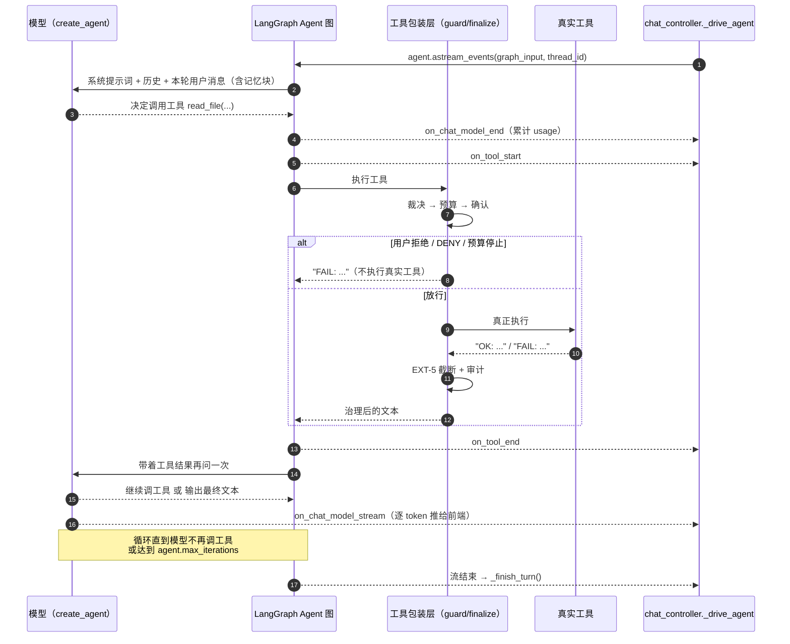

# 01 · 大模型调用链路

> 入口：前端 `frontend/src/services/chat.ts` 的 `chat_stream()` → `POST /api/chat/stream`
> 后端主函数：`backend/app/controllers/chat_controller.py:1569` `_run_agent_stream()`

## 1.1 一次聊天的完整链路（含全部模型调用点）

```mermaid
flowchart TD
    U["用户输入<br/>ChatInput.vue"] --> S["chat store 发送<br/>stores/chat.ts"]
    S --> API["POST /api/chat/stream<br/>SSE 长连接"]
    API --> STREAM["_run_agent_stream()<br/>chat_controller.py:1569"]

    STREAM --> THINK["假思考 1~3s<br/>_fake_think('analyzing')"]
    THINK --> PEND{"上一轮还停在<br/>确认弹窗？"}
    PEND -->|"是"| ERR1["error 事件<br/>要求先处理确认"]
    PEND -->|"否"| START["_start_turn()<br/>· 记用户原话<br/>· 登记预算 start_budget<br/>· 开轨迹 begin_turn<br/>· 清任务状态<br/>· 落库用户消息"]

    START --> READY["thinking: session_ready"]
    READY --> SKILL{"输入以 / 开头<br/>且命中技能？"}
    SKILL -->|"命中"| SKILLOK["展开成「说明书 + 参数」<br/>slash.expand()"]
    SKILL -->|"未命中"| SKILLBAD["_finish_with_answer()<br/>列出可用技能后结束"]
    SKILL -->|"不是指令"| MEMJUDGE

    SKILLOK --> MEMJUDGE{"是新对话的<br/>第一条消息？"}
    MEMJUDGE -->|"是"| MEMINJ["本地检索记忆<br/>memory_service.build_injection()<br/>（不调模型）"]
    MEMJUDGE -->|"否"| COMPRESS
    MEMINJ --> COMPRESS{"历史超阈值？<br/>context.auto_compress"}
    COMPRESS -->|"是"| C1["【模型调用 ①】<br/>摘要压缩<br/>_maybe_compress()"]
    COMPRESS -->|"否"| ROUTER
    C1 --> ROUTER

    ROUTER{"task.decompose_enabled<br/>且 looks_complex()？"}
    ROUTER -->|"否（绝大多数）"| SINGLE["单 agent 直跑<br/>_drive_agent(finalize=True)"]
    ROUTER -->|"是"| PLAN["【模型调用 ②】<br/>判定 + 拆分（一次调用）<br/>task_planner.make_plan()"]

    PLAN --> ISCOMPLEX{"判定为复杂？"}
    ISCOMPLEX -->|"否"| SINGLE
    ISCOMPLEX -->|"是"| CONFLICT{"子任务写同一批文件？<br/>task.conflict_policy"}
    CONFLICT -->|"block 策略"| SINGLE
    CONFLICT -->|"merge / serialize"| PLANEV["plan 事件<br/>前端初始化 Todo"]
    PLANEV --> LOOP["_drive_tasks()<br/>逐个执行子任务"]

    LOOP --> SUB["task_start 事件<br/>_drive_agent(finalize=False)"]
    SUB --> SUBDONE{"跑完 / 被确认打断？"}
    SUBDONE -->|"被打断"| WAIT["confirm_required<br/>本次流结束，等 /chat/resume"]
    WAIT --> RESUME["/chat/resume<br/>_run_resume_stream()<br/>不重发指令，只收尾"]
    RESUME --> SUBDONE
    SUBDONE -->|"跑完"| VERIFY["_complete_subtask()<br/>可选校验命令<br/>task.verify_command"]
    VERIFY --> MORE{"还有子任务？"}
    MORE -->|"有"| SUB
    MORE -->|"没有"| SUM["【模型调用 ③】<br/>汇总各子任务<br/>task_planner.summarize()"]

    SUM --> FINISH
    SINGLE --> FINISH["_finish_turn()<br/>· done 事件 + usage/cost<br/>· 落库回答<br/>· 结束轨迹"]

    FINISH --> MEMX["【模型调用 ④】后台<br/>记忆抽取<br/>asyncio.create_task"]
    FINISH --> SSE["SSE: done<br/>前端关闭气泡"]
    MEMX -.->|"不阻塞、失败只记日志"| IGN["（无用户可见影响）"]

    style C1 fill:#fff3cd,stroke:#d39e00
    style PLAN fill:#fff3cd,stroke:#d39e00
    style SUM fill:#fff3cd,stroke:#d39e00
    style MEMX fill:#e2e3e5,stroke:#6c757d
    style FINISH fill:#d4edda,stroke:#28a745
```



**文字版步骤**（与图一一对应）：

1. 前端 `POST /api/chat/stream`（SSE），后端进入 `_run_agent_stream()`
2. 先推 1~3 秒"正在理解"的假思考事件（纯 UI，不调模型）
3. 若上一轮还停在确认弹窗 → 直接报错，要求先处理确认
4. `_start_turn()`：记用户原话、登记本轮预算、开启执行轨迹、清空上一轮任务状态、落库用户消息
5. `/技能名` 指令：命中则把技能正文展开成"说明书 + 参数"；未命中则列出可用技能并结束
6. **仅新对话的首条消息**：本地检索工作区记忆并前置注入（不调模型）
7. 历史超阈值 → **模型调用 ①**：摘要压缩（这次调用也计入本轮用量/费用）
8. 判断要不要拆任务：启发式 `looks_complex()` 先筛，明显简单的直接走单 agent（**一次模型调用都不花**）
9. **模型调用 ②**：一次调用同时产出"要不要拆"和"怎么拆"
10. 冲突策略为 `block` 且确实有文件冲突 → 退回单 agent
11. 进入 `_drive_tasks()`：逐个子任务 `_drive_agent(finalize=False)`（不发 done、不落库）
12. 子任务里的写操作会 `interrupt()` → 推 `confirm_required` 结束本次流；`/chat/resume` 恢复时**不重发指令**，只收尾当前子任务
13. 每个子任务跑完可跑校验命令（不是模型调用，是子进程）
14. 全部跑完 → **模型调用 ③**：汇总
15. `_finish_turn()`：推 `done`（含真实 usage / cost / 子任务结果）、落库回答、结束轨迹
16. **模型调用 ④**：后台异步抽取记忆（不阻塞；失败只写日志）

## 1.2 Agent 内部循环：模型与工具怎么往返

这一步是"必然发生"的模型调用，也是延迟的主要来源：**每一次工具调用都要多一轮模型往返**。



**事件映射**（`_drive_agent` 里 `kind == ...` 的分支，chat_controller.py:1394-1419）：

| LangChain 事件 | 后端动作 | 前端收到 | 备注 |
| --- | --- | --- | --- |
| `on_chat_model_stream` | 累加文本 | `token` | 逐字上屏 |
| `on_chat_model_end` | 累加 `usage_metadata` → 本轮用量与预算 | —— | 费用统计的唯一来源 |
| `on_tool_start` | 记轨迹 `tool_call`、记开始时间 | `tool_start` | 前端画"正在执行…" |
| `on_tool_end` | 读 EXT-5 截断元数据、记 `tool_result` | `tool_end`（带 `total_chars` / `truncated` / `continuation_ref`） | 工具轨迹卡片 |
| 图暂停（interrupt） | 落 `pending_confirm`、记 `interrupt_id` | `confirm_required` | 本次流结束，等 `/chat/resume` |
| 用户点终止 | 停止消费、发已生成部分 | `stopped` | 已产出的文本不丢 |
| 异常 | 记 `error` 轨迹 | `error` | 异常类型只在 `debug=true` 时下发 |

> `agent.max_iterations`（默认 25）是**递归步数**上限，模型一次 + 工具一次各算一步，
> 大约相当于 12 轮工具调用。超限时走 `finish_reason=error` 并把已产出的文本给用户。

## 1.3 全部模型调用点清单（成本视角）

| # | 触发条件 | 位置 | 调用方式 | 是否计入本轮用量/成本 |
| --- | --- | --- | --- | --- |
| ① | 历史估算超 `context.compress_threshold` | `chat_controller.py:999` `_maybe_compress` | `ainvoke`（裸模型） | ✅ 计入（`_accumulate_usage` 在 1049 行） |
| ② | `task.decompose_enabled` 且 `looks_complex()` 通过 | `services/task_planner.py:175` `make_plan` | `ainvoke`（裸模型） | ❌ **未计入**（缺口，见 §1.3.1） |
| ③ | 全部子任务结束时 | `services/task_planner.py:255` `summarize` | `ainvoke`（裸模型） | ❌ **未计入**（同上） |
| ④ | 每轮 `done`/`stopped` 且回答 ≥ 20 字 | `services/memory_service.py:567` `extract_and_store` | `ainvoke`（裸模型，后台） | ❌ 不计入（发生在 `_finish_turn` 之后，属"背景开销"） |
| 主循环 | 必然发生 | `agents/rag_agent.py:210` `create_agent_graph` | `astream_events`（挂工具） | ✅ 计入（`on_chat_model_end`，1409 行） |
| `\doc` 问答 | 用户敲 `\doc 问题` | `chat_controller.py:2016` `_doc_search` | `astream`（裸模型） | ✅ 计入（2022 行） |
| 记忆问答 | `POST /api/memory/query` | `controllers/memory_controller.py:195` | `astream`（裸模型） | ❌ 独立接口，不在会话轮次里 |

### 1.3.1 已知缺口：拆分与汇总的 token 没进成本统计

`_accumulate_usage()` 只有三个调用点（`chat_controller.py:1049 / 1409 / 2022`），
而 `task_planner.make_plan()` / `summarize()` 拿的是裸模型、**没有任何回调把用量交回控制器**。

后果：开了「复杂任务拆分」之后，右栏「本轮」的 token 与费用会**偏小**——
拆分（一次）+ 汇总（一次）这两次调用完全不记。长任务里这个误差不小。

**修法（两条都行，推荐第一条）**：
1. `make_plan` / `summarize` 增加可选参数 `on_usage: Callable[[Any], None] | None`，
   控制器传进去包一层 `_accumulate_usage`（改动小、不动签名兼容性）；
2. 在控制器里把 `get_model()` 的返回值包一层代理，统一拦截 `ainvoke/astream` 的用量——
   范围更大，但能一并覆盖以后新增的裸模型调用。

> 这条是画图时对账发现的，尚未修（本轮只出文档）。

三条设计约束（改代码时别破坏）：

1. **裸模型 = 不挂工具**。压缩、拆分、汇总、抽取、`\doc` 问答都走 `get_model()`（不带 tools）：
   挂上工具会让它跑去执行、把任务带偏，也让一次轻量调用变成一串动作。
2. **只有主循环与 `\doc` 会流式输出给用户**，其余都是"内部过程"，结果以事件或字段形式出现。
3. **`task_planner` 的判定与拆分合成一次调用**：拆出来的第一次调用只输出一个布尔值，性价比太低，
   所以先用 `looks_complex()` 做启发式预筛，简单请求连这次调用都不发。

## 1.4 Agent 缓存：什么时候会重新建图

`llm/state.py` 用"设置指纹"缓存编译好的 Agent 图（`_settings_fingerprint`，state.py:56）：

```
指纹 = scope + provider + model + temperature + max_iterations + 技能名清单 + MCP 工具名清单
```

指纹变了才重建图（`get_agent()`，state.py:147）。所以：

- 改模型/温度/步数上限 → 下一轮自动生效；
- 装/停用技能、改 MCP server → 下一轮自动生效（`POST /skills/reload` 与 `POST /mcp/reload` 会主动失效缓存）；
- **改系统提示词常量不会自动生效**，需要重启或触发一次缓存失效——这也是记忆注入没有走系统提示词、而是
  塞进本轮用户消息的原因（见 doc/25 §13.4）。
