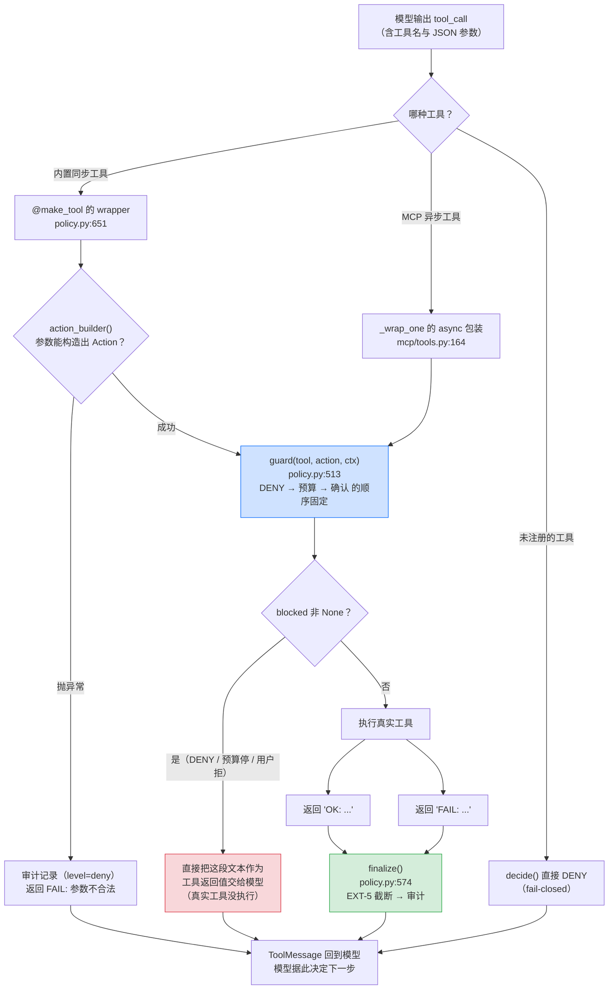
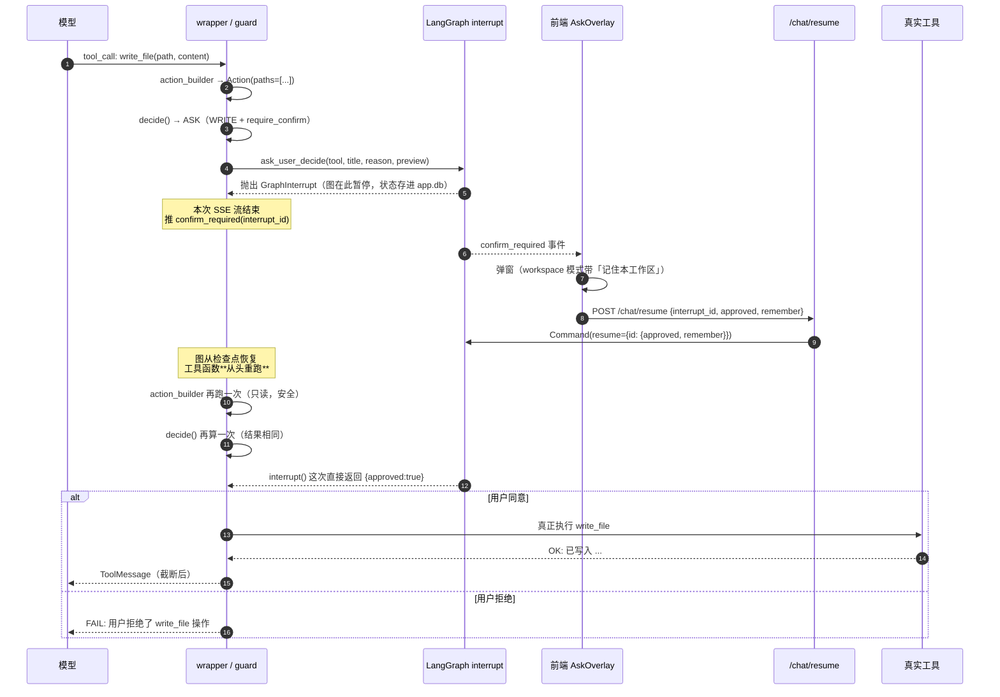
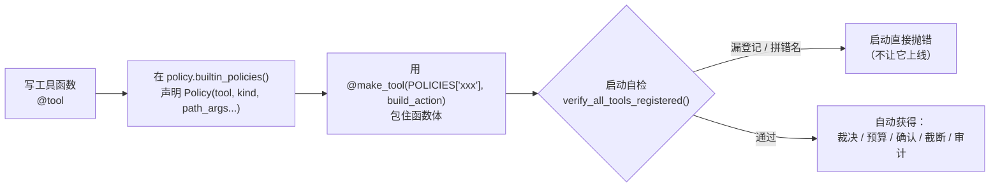

# 02 · 工具执行与判断

> 核心约束：**工具不自己判断该不该问、该不该拒**，它只声明"我要做什么"，由统一的关卡裁决。
> 落地方式有两种写法、同一套语义：
> - 同步内置工具：`@make_tool(POLICIES["xxx"], build_action)`（`app/tools/policy.py:624`）
> - 异步 MCP 工具：`wrap_server_tools()` 包成新 `StructuredTool`（`app/mcp/tools.py:164`）

## 2.1 所有工具的统一关卡

**文字版步骤**：

1. 模型输出 `tool_call` → LangGraph 按工具名找到已注册的工具对象
2. 内置工具走 `@make_tool` 的 `wrapper`；MCP 工具走 `_wrap_one` 的异步包装（两者都调用同一个 `guard()`）
3. 先用 `action_builder(*args, **kwargs)` 把参数解释成 `Action`（工具最清楚哪个参数是路径、哪个是命令）
   - 构造失败（参数缺字段、类型不对）→ 审计记一条 `level=deny`，直接返回 `FAIL: 参数不合法`
4. `guard()`：**裁决 → 预算 → 确认**，顺序不可调换（见 03 文档）
5. `blocked` 非空 → 把这段文本当工具结果返回，**真实工具一次都没执行**
6. 否则执行真实工具，得到 `OK:` / `FAIL:`
7. `finalize()`：先 EXT-5 截断（超阈值落盘续读），再写审计——顺序很关键，
   保证"模型看到的"与"审计记下来的"是同一份文本
8. 结果以 `ToolMessage` 回到模型，模型决定继续调工具还是给最终回答

## 2.2 一次"要确认"的工具调用到底发生了什么

这张图是最容易误解的地方：**`interrupt()` 会让工具函数从头重跑**，所以工具函数"产生副作用之前"的部分必须都是只读的。

三个容易踩的坑：

1. **副作用必须放在 `ask_user` 之后**。写在它之前的"顺手建个目录""先备份一下"都会在用户点确认时执行两次。
2. **不要在工具里再判断权限模式**。模式只在 `_resolve_ask()` 里生效，工具自己判断会和统一决策链打架。
3. **工具的 `except` 要放行 `GraphBubbleUp`**，否则 `interrupt()` 抛出的控制流异常会被当成业务错误吞掉。

## 2.3 每个工具的判断结果（当前全集）

`kind` 决定默认等级（`policy.py:303` 的 `_DEFAULT_LEVEL`）；`require_confirm` 与 `default_level` 会覆盖它。
**没有显式声明的写/执行/联网/外部工具，默认 DENY**——这是故意的，逼着新工具去登记。

| 工具 | kind | 校验的路径参数 | 默认等级 | 为什么是这个等级 |
| --- | --- | --- | --- | --- |
| `list_dir` | READ | `path`（读） | ALLOW | 只读列表，系统目录已在路径解析层拦掉 |
| `read_file` | READ | `path`（读） | ALLOW | 只读；顺带登记"读快照"供写前校验 |
| `grep_files` | READ | `root`（读） | ALLOW | 只读搜索 |
| `glob` | READ | `root`（读） | ALLOW | 只读匹配 |
| `list_indexed_docs` | READ | —— | ALLOW | 只读数据库 |
| `rag_search` | READ | —— | ALLOW | 只读检索 |
| `list_skills` | READ | —— | ALLOW | 只读清单 |
| `read_skill` | READ | —— | ALLOW | 只读正文（技能本身是提示词，风险在它指引你调用的工具上） |
| `index_path` | WRITE | `path`（**读**校验） | ASK | 写的是数据库，源文件只读；可能解析上百个文件 |
| `delete_index` | WRITE | —— | ASK | 知识库记录不可恢复 |
| `write_file` | WRITE | `path`（写） | ASK | 每一次落盘都必须让用户看到（新建与覆盖都要） |
| `edit_file` | WRITE | `path`（写） | ASK | 改错会破坏原内容（有 `.bak` 兜底仍要问） |
| `file_ops` | WRITE | 由工具自行校验 | ASK | 一次调用可能移动/删除多个文件 |
| `run_command` | EXEC | `cwd`（执行） | ASK | 命令在你机器上真实执行，最高危 |
| `web_search` | NET | —— | **DENY → 开启后 ASK** | 默认关闭（`APP_ALLOW_WEB_TOOLS=true` 才可用）；会把搜索词发到外部 |
| `web_fetch` | NET | —— | **DENY → 开启后 ASK** | 同上；抓回的内容属不可信数据 |
| `mcp__<server>__<tool>` | MCP | 由 server 决定 | **DENY → 显式配置后 ASK/ALLOW** | 本地无法判断外部工具做了什么；默认拒绝，需在 `mcp.auto_approve_tools` 或策略里显式放行 |

> 表里"开启后 ASK"的意思是：`off_by_default=True` 且功能未开启时，`decide()` 的第 3 步就返回 DENY
> （连弹窗都不会有，用户得先去设置里打开）；开启之后才走到等级判定，得到 ASK。

## 2.4 加一个新工具必须做的三件事

1. **声明策略**：`builtin_policies()` 里加一条。`path_args` 必须列全——漏一个路径参数，那个参数就能绕过工作区限制。
2. **套 `@make_tool`**：装饰顺序不能反，`@tool` 必须在外层（LangChain 先看到函数，再由它包装成工具）。
3. **跑启动自检**：`verify_all_tools_registered()` 在 `build_tools()` 里会再跑一次（覆盖运行时发现的 MCP 工具），
   漏登记会在**启动时**暴露，而不是等某天被越权访问才发现。

MCP 工具不需要手写策略：`wrap_server_tools()` 会为每个 `mcp__server__tool` 动态登记
`Kind.MCP` + `default_level`（免确认名单命中则为 ALLOW，否则 ASK）。
