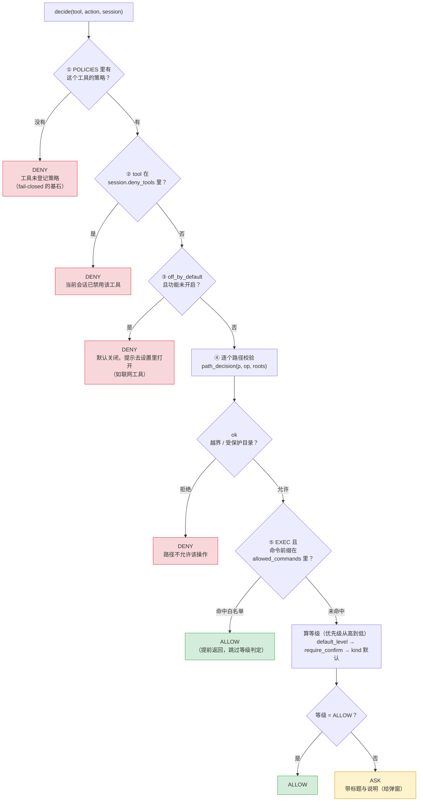
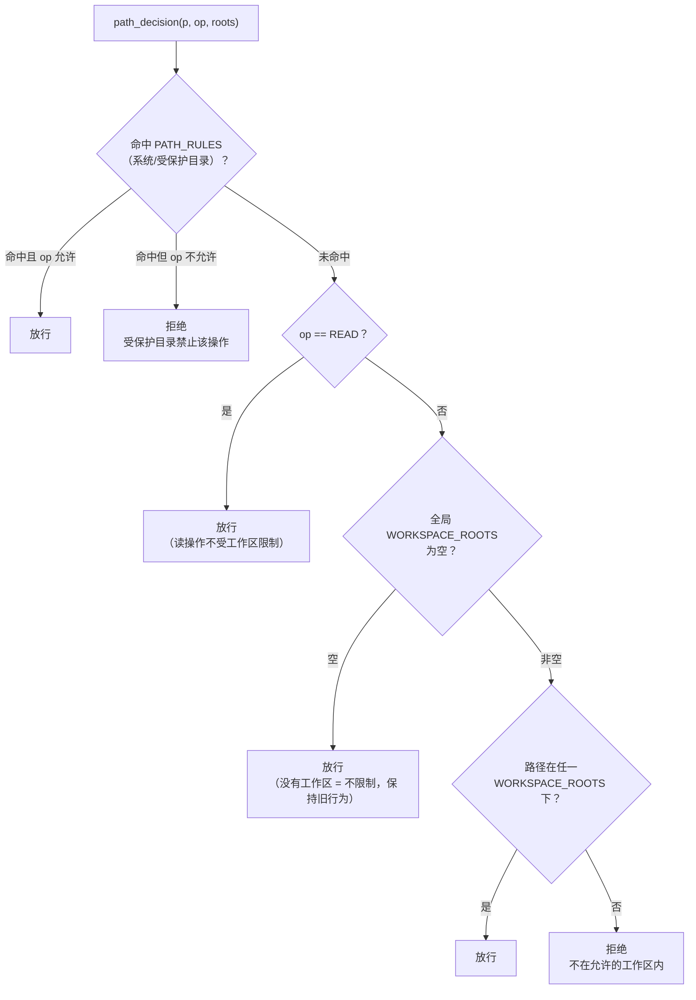
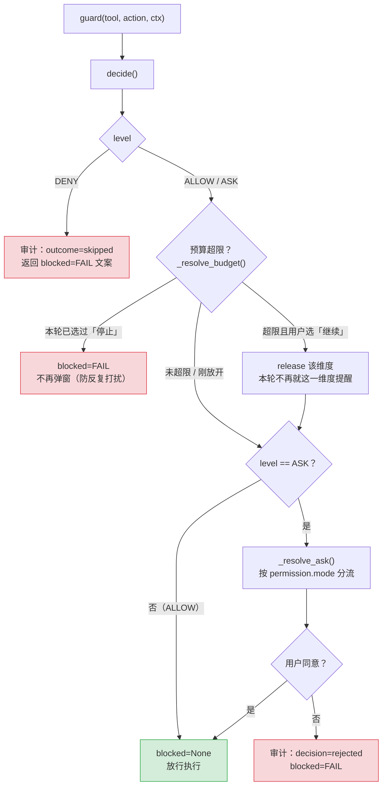
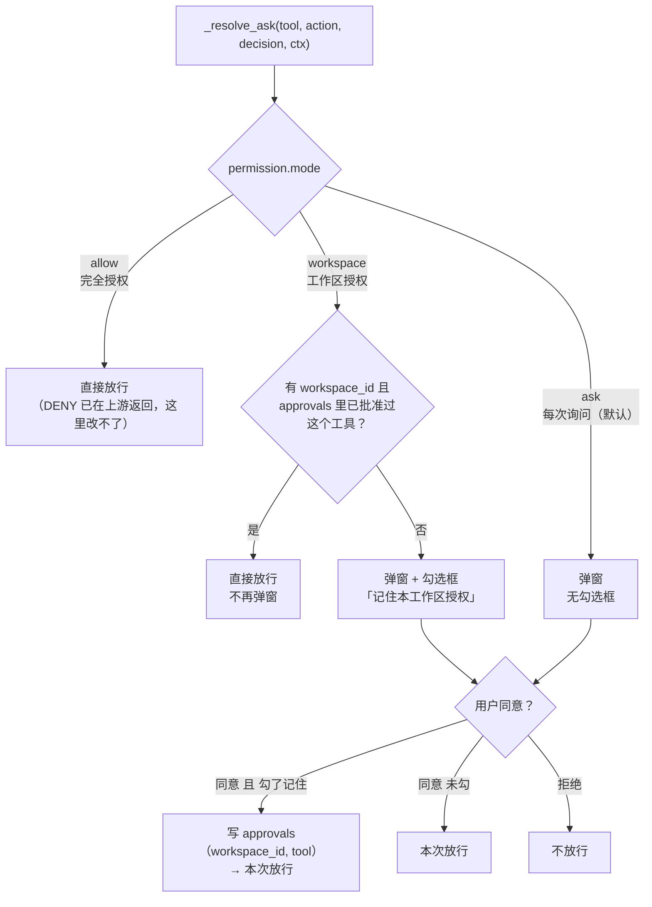

# 03 · 权限判断流程

> 决策入口只有一个：`backend/app/tools/policy.py:312` `decide()`
> 执行入口只有一个：`policy.py:513` `guard()`（内置工具与 MCP 工具共用）
> **本文件按代码实际行为绘制**，第 3.5 节记录了两处「注释/文档说的」与「代码做的」不一致（已实测确认）。

## 3.1 decide() 的判定顺序（顺序不可交换）



**文字版步骤**（`decide()` 从上到下，遇到 DENY 立即返回）：

1. **查策略**：`POLICIES.get(tool)` 为空 → DENY。这是整个模型的基石：没登记就不许跑。
2. **会话禁用**：`tool in session.deny_tools` → DENY（用户在界面上关掉的能力）。
3. **默认关闭**：`policy.off_by_default and not _feature_enabled(tool)` → DENY。目前只有 `web_search` / `web_fetch`，
   需要 `APP_ALLOW_WEB_TOOLS=true` 才可用。
4. **路径校验**：对 `action.paths` 里每个路径调 `path_decision(p, op, roots=session.workspace_roots)`，
   任何一个返回原因 → DENY。`op` 取 `policy.path_op`，没写就用 `kind`。
5. **命令白名单**（仅 EXEC）：取 `target` 前两个词（如 `git status`），命中 `allowed_commands` → **直接 ALLOW**。
6. **算等级**：`default_level` 优先 → 其次 `require_confirm=True` 得 ASK → 否则按 `kind` 查默认表。
   等级为 ALLOW 就放行，**否则一律 ASK**。

### 路径校验的实际规则（第 4 步展开）



**这里有一个必须知道的实现细节**：`path_decision` 的形参 `roots` **没有被使用**
（`tool_utils.py:382` 算出 `effective_roots` 后就再没读它，后面三处判断读的都是模块全局 `WORKSPACE_ROOTS`）。
详见 §3.5 第 1 条。

## 3.2 guard() 的执行顺序：DENY 一定在最前面



**顺序为什么必须是「裁决 → 预算 → 确认」**：

- 裁决在最前：DENY 的操作连"弹预算框"的资格都没有，更不该让用户误以为"点继续就能跑"。
- 预算在确认之前：否则会连着弹两个框（先"同意执行"、再"预算超了"），体验很差。
- 拒绝路径统一返回 `blocked`，调用方直接把文本交给模型，**真实工具一次都不执行**。

## 3.3 三档权限模式：只作用于 ASK



| 模式 | 语义 | 写入授权表 | 典型场景 |
| --- | --- | --- | --- |
| `ask`（默认） | 每次都问 | 否 | 首次使用、不确定时 |
| `workspace` | 本工作区首次批准后可「记住」，同类操作不再问 | **仅当用户勾选** | 长期在同一个项目里干活 |
| `allow` | 完全授权，跳过所有确认弹窗 | 否 | 信任的临时目录、批量重构 |

**安全不变量（改代码时别破坏）**：

1. **模式只影响 ASK**。`decide()` 的四个 DENY 分支在 `_resolve_ask()` 之前就已返回，
   `allow` 模式也绕不过"未登记策略 / 会话禁用 / 默认关闭 / 路径越界"。
2. **读不到 `permission.mode` 时回退 `ask`**（`tools/session.py`）。"读配置失败"绝不能等于"默认放行"。
3. **`ask` 模式永不写授权表**：只有用户主动勾了「记住」才写。
4. **写授权失败不影响本次放行**（`approval_service` 内部吞异常），但也不会因此放宽下次。

## 3.4 DENY 的触发条件全集

| 触发点 | 条件 | 用户看到什么 | 能绕过吗 |
| --- | --- | --- | --- |
| ① 未登记策略 | `POLICIES` 里没有这个工具 | `FAIL: 工具 X 没有登记安全策略` | 不能（任何模式都拦） |
| ② 会话禁用 | `session.deny_tools` 含该工具 | `FAIL: 当前会话已禁用工具 X` | 不能 |
| ③ 默认关闭 | `off_by_default` 且功能未开启 | `FAIL: 默认关闭。开启方法：…` | 需要改配置并重启，不是点弹窗 |
| ④ 路径越界 | 受保护目录不允许该 op，或不在工作区内 | `FAIL: … 禁止 write 操作` | 不能 |
| 预算停止 | 本轮超限且用户选「停止」 | `FAIL: 用户因为预算超出…选择停止本轮` | 不能（本轮内） |
| 用户拒绝 | ASK 弹窗点了拒绝 | `FAIL: 用户拒绝了 X 操作` | 不能（本次调用） |

注意最右列：**没有任何"模式"能把这些变成放行**。`permission.mode=allow` 只跳过弹窗，不跳过裁决。

## 3.5 代码与注释不一致的两处（已实测确认，待修）

> 这两条是画图时逐个函数核对发现的，**不是设计如此**。用户要求"先都不做"，所以这里只记录，没有改代码。

### ① `path_decision` 的 `roots` 参数被忽略

`tool_utils.py:382`：

```python
effective_roots = list(roots) if roots is not None else WORKSPACE_ROOTS
# ↑ 算完之后没人用
if op == OP_READ or not WORKSPACE_ROOTS:      # ← 读的是全局
if any(same_or_under(p, root) for root in WORKSPACE_ROOTS):   # ← 还是全局
```

实测：`path_decision(越界路径, OP_WRITE, roots=[只含A的列表])` 返回 `None`（放行），
把全局 `WORKSPACE_ROOTS` 设成 A 之后才正确拒绝。

**影响**：`decide()` 传进来的 `session.workspace_roots` 目前是装饰性的。当前两者恰好一致
（`session.py` 就是从 `get_active_roots()` 取的、并由 `workspace_settings_defs` 订阅刷新全局），
所以**今天没有行为差异**；但一旦有人想让"某个会话用更小的白名单"，会发现根本没生效。

**建议修法**：把后两处 `WORKSPACE_ROOTS` 换成 `effective_roots`（3 行改动 + 一条用例）。

### ② `_DEFAULT_LEVEL` 里的 DENY 实际会退化为 ASK

`policy.py:362-377`：

```python
level = ...  # 可能来自 default_level（甚至显式写成 DENY）
if level is Level.ALLOW:
    return Decision(Level.ALLOW)
return Decision(Level.ASK, ...)   # ← 只要不是 ALLOW 就返回 ASK
```

实测：`Policy(kind=Kind.WRITE)`（没有 `require_confirm`）→ 返回 **ASK**；
`Policy(kind=Kind.MCP)` 不给 `default_level` → 也是 **ASK**；只有"未登记"才真的 DENY。

**影响**：
- 注释里"未声明的写/执行操作一律拒绝"实际上变成了"一律弹窗询问"——**偏安全**（仍需用户同意），
  但与"fail-closed"的表述不一致；
- 更要紧的是：**`Policy.default_level=Level.DENY` 无法表达"硬拒绝某个工具"**（比如想彻底禁掉某个 MCP 工具）。
  目前只能靠"不注册策略"来达到 DENY 效果。

**建议修法**：把最后一段改成显式三态：

```python
if level is Level.ALLOW:  return Decision(Level.ALLOW)
if level is Level.DENY:   return Decision(Level.DENY, reason=...)
return Decision(Level.ASK, ...)
```
并在 `builtin_policies()` 里保留现状（`require_confirm=True`），行为不变、语义变正确。

## 3.6 相关文件索引

| 关注点 | 文件 | 位置 |
| --- | --- | --- |
| 操作类型 / 等级枚举 | `app/tools/policy.py` | 45-70 |
| 策略注册表与内置策略 | `app/tools/policy.py` | 162-246 |
| 默认等级表 | `app/tools/policy.py` | 303-309 |
| 裁决 | `app/tools/policy.py` | 312 |
| 三档模式分流 | `app/tools/policy.py` | 407 `_resolve_ask` |
| 预算熔断 | `app/tools/policy.py` | 454 `_resolve_budget` |
| 执行关卡 / 收尾 | `app/tools/policy.py` | 513 `guard` / 574 `finalize` |
| 内置工具装饰器 | `app/tools/policy.py` | 624 `make_tool` |
| 启动自检 | `app/tools/policy.py` | 683 `verify_all_tools_registered` |
| 路径规则 | `app/tools/tool_utils.py` | 305 `WORKSPACE_ROOTS` / 335 `PATH_RULES` / 362 `path_decision` |
| 会话上下文（模式/工作区来源） | `app/tools/session.py` | `current_context()` |
| 工作区授权表 | `app/entity/approval.py`、`app/services/approval_service.py` | —— |
| MCP 工具的同一套关卡 | `app/mcp/tools.py` | 164 `_wrap_one`（调 `guard` / `finalize`） |
